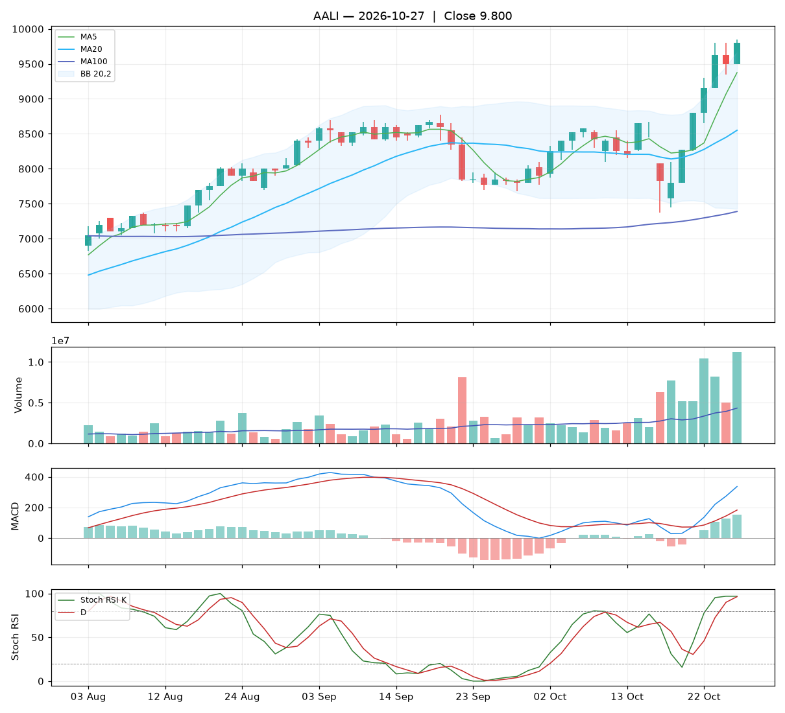

# Analisa harian AALI — 2026-10-27

## Ringkasan

| Open | High | Low | Close | Perubahan | Volume |
|---|---|---|---|---|---|
| 9.500 | 9.850 | 9.500 | **9.800** | +300 (+3.16%) | 11.270.000 |

### 🟢 Keputusan teknikal: **BELI** — nilai total **8.2/10**

Mayoritas indikator searah naik dan tren mendukung.

| Aspek | Nilai | |
|---|---|---|
| Tren | **10.0**/10 | `██████████` |
| Volume | **9.1**/10 | `█████████░` |
| Stochastic | **3.5**/10 | `████░░░░░░` |
| Momentum | **9.5**/10 | `██████████` |
| Candle | **8.3**/10 | `████████░░` |

**Level harga (otomatis):**

- Support 20 hari: 7.375 · Resistance 20 hari: 9.850
- Batas rugi (stop loss): 7.375 (di bawah support atau −5%)
- Target 1: 9.850 · Target 2: 9.674
- Rasio untung : rugi ke target 1 = 0.02 : 1 (kurang menarik, idealnya ≥ 1,5)

## 1. Candlestick

Candle hijau (ditutup naik). Badan 86% dari rentang hari ini, sumbu atas 14%, sumbu bawah 0%.

- 🟢 **Bullish engulfing** — Badan hijau menelan badan merah sebelumnya: pembeli mengambil alih.

## 2. Volume

- Volume hari ini 11.270.000 lembar, rata-rata 20 hari 4.337.860 (**2.60x** rata-rata).
- Volume tinggi saat harga naik: kenaikan didukung minat beli yang kuat.
- 5 hari terakhir: volume candle hijau 87%, candle merah 13%.

## 3. Stochastic & Stoch RSI

- Stochastic (14,3,3): %K 92.8, %D 92.9, zona **jenuh beli (overbought)**.
- Stoch RSI (14,14,3,3): K 96.9, D 96.3, zona **overbought**.
- K di atas D: momentum masih naik.

## 4. Tren (Moving Average)

Tren jangka pendek: **naik** (MA20 berubah 389 dalam 5 hari).
- Harga di atas MA5 (9.375).
- Harga di atas MA20 (8.550).
- Harga di atas MA100 (7.390).

## 5. Bollinger Bands

- Bollinger (20,2): atas 9.674, tengah 8.550, bawah 7.426. Posisi harga 106% dari pita bawah ke atas, lebar pita 26.3%.
- Harga menyentuh / menembus pita atas: jenuh beli, tapi bisa juga tanda tren naik kuat.

## 6. MACD & RSI

- MACD (12,26,9): garis 336.66, sinyal 182.98, histogram 153.68.
- Histogram membaik dibanding kemarin: tekanan turun berkurang / tekanan naik bertambah.
- RSI (14): 69.7.

## 7. Support & Resistance

- Support 20 hari (low terendah): 7.375.
- Resistance 20 hari (high tertinggi): 9.850.
- Resistance terdekat lain: MA20 8.550, MA100 7.390.

## 8. Fundamental (laporan keuangan)

**Nilai fundamental: 9.2/10 — Kuat** (terpisah dari keputusan teknikal; dipakai untuk menilai kualitas perusahaan jangka panjang).

| PER | PBV | ROE | DER | Margin laba | Pendapatan YoY | Laba YoY | Kapitalisasi |
|---|---|---|---|---|---|---|---|
| 10.2 | 0.79 | 8.1% | 0.00x | 6.3% | 10.4% | 161.9% | 18.86 T |

Laporan laba rugi per kuartal (miliar Rp):

| Periode | Pendapatan | Laba bersih |
|---|---|---|
| 2026-06-30 | 7757.2 | 725.5 |
| 2026-03-31 | 7501.8 | 373.4 |
| 2025-12-31 | 6535.9 | 401.6 |
| 2025-06-30 | 7422.8 | 425.1 |
| 2025-03-31 | 7024.0 | 277.0 |

| Kondisi | Poin |
|---|---|
| PER 10.2x: wajar | +0.25 |
| PBV 0.79x: di bawah nilai buku | +0.75 |
| ROE 8%: cukup | +0.50 |
| DER 0.00x: utang rendah | +0.75 |
| Pendapatan tumbuh +10% YoY | +0.42 |
| Laba bersih tumbuh +162% YoY | +1.50 |

_Sumber: Yahoo Finance. Untuk keputusan penting, cocokkan dengan laporan resmi di idx.co.id._

## 9. Cara nilai teknikal dihitung

Setiap aspek mulai dari **5** (netral), lalu ditambah atau dikurangi poin di bawah ini, dan dibatasi 0–10. Nilai total = rata-rata berbobot.

**Tren: 10.0/10** (bobot 25%)

| Kondisi | Poin |
|---|---|
| Harga di atas MA5 | +1.00 |
| Harga di atas MA20 | +1.50 |
| Harga di atas MA100 | +1.50 |
| MA20 menanjak dalam 5 hari | +1.00 |

**Volume: 9.1/10** (bobot 20%)

| Kondisi | Poin |
|---|---|
| Harga naik dengan volume 2.60x rata-rata 20 hari | +2.60 |
| Volume hijau 5 hari 87% (akumulasi vs distribusi) | +1.50 |

**Stochastic: 3.5/10** (bobot 20%)

| Kondisi | Poin |
|---|---|
| Stochastic: K di bawah D | -0.75 |
| Stochastic overbought (93): rawan koreksi | -0.75 |
| Stoch RSI: K di atas D | +0.75 |
| Stoch RSI overbought (97): rawan koreksi | -0.75 |

**Momentum: 9.5/10** (bobot 20%)

| Kondisi | Poin |
|---|---|
| MACD di atas garis sinyal | +1.50 |
| MACD di atas nol | +1.00 |
| Histogram MACD membaik | +1.00 |
| RSI 70 di zona kuat (50–70) | +1.00 |

**Candle: 8.3/10** (bobot 15%)

| Kondisi | Poin |
|---|---|
| Badan candle hijau 86% dari rentang | +1.29 |
| Pola Bullish engulfing | +2.00 |

_Laporan ini dibuat otomatis dari aturan teknikal sederhana. Bukan rekomendasi beli atau jual; selalu kombinasikan dengan analisa sendiri dan manajemen risiko._
