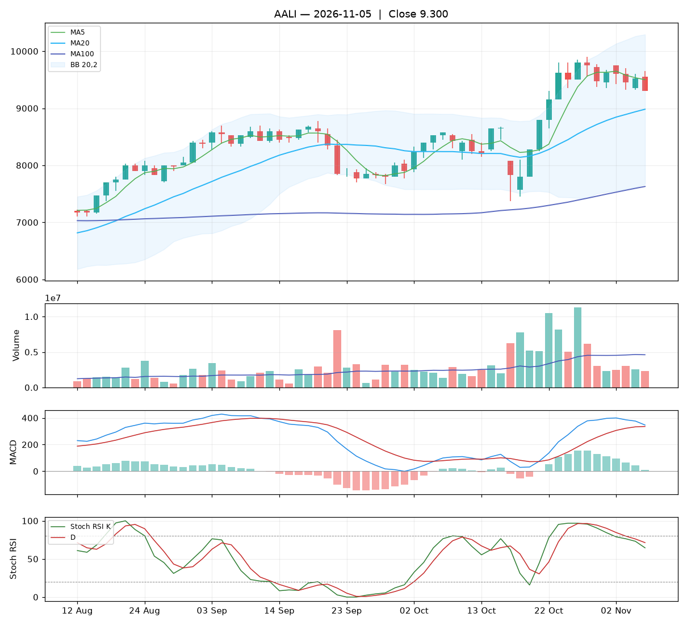

# Analisa harian AALI — 2026-11-05

## Ringkasan

| Open | High | Low | Close | Perubahan | Volume |
|---|---|---|---|---|---|
| 9.550 | 9.650 | 9.300 | **9.300** | -225 (-2.36%) | 2.324.800 |

### ⚪ Keputusan teknikal: **TUNGGU** — nilai total **5.1/10**

Sinyal campur aduk. Belum ada alasan teknikal yang jelas untuk masuk.

| Aspek | Nilai | |
|---|---|---|
| Tren | **8.0**/10 | `████████░░` |
| Volume | **4.0**/10 | `████░░░░░░` |
| Stochastic | **2.8**/10 | `███░░░░░░░` |
| Momentum | **7.5**/10 | `████████░░` |
| Candle | **1.9**/10 | `██░░░░░░░░` |

**Level harga (otomatis):**

- Support 20 hari: 7.375 · Resistance 20 hari: 9.900
- Batas rugi (stop loss): 7.375 (di bawah support atau −5%)
- Target 1: 9.900 · Target 2: 10.294
- Rasio untung : rugi ke target 1 = 0.31 : 1 (kurang menarik, idealnya ≥ 1,5)

## 1. Candlestick

Candle merah (ditutup turun). Badan 71% dari rentang hari ini, sumbu atas 29%, sumbu bawah 0%.

- 🔴 **Bearish engulfing** — Badan merah menelan badan hijau sebelumnya: penjual mengambil alih.

## 2. Volume

- Volume hari ini 2.324.800 lembar, rata-rata 20 hari 4.613.985 (**0.50x** rata-rata).
- Volume sepi: pergerakan hari ini kurang meyakinkan.
- 5 hari terakhir: volume candle hijau 38%, candle merah 62%.

## 3. Stochastic & Stoch RSI

- Stochastic (14,3,3): %K 80.9, %D 84.2, zona **jenuh beli (overbought)**.
- Stoch RSI (14,14,3,3): K 64.6, D 71.4, zona **tengah**.
- K di bawah D: momentum masih turun.

## 4. Tren (Moving Average)

Tren jangka pendek: **naik** (MA20 berubah 266 dalam 5 hari).
- Harga di bawah MA5 (9.500).
- Harga di atas MA20 (8.982).
- Harga di atas MA100 (7.629).

## 5. Bollinger Bands

- Bollinger (20,2): atas 10.294, tengah 8.982, bawah 7.671. Posisi harga 62% dari pita bawah ke atas, lebar pita 29.2%.

## 6. MACD & RSI

- MACD (12,26,9): garis 346.76, sinyal 335.73, histogram 11.03.
- Histogram memburuk dibanding kemarin.
- RSI (14): 56.8.

## 7. Support & Resistance

- Support 20 hari (low terendah): 7.375.
- Resistance 20 hari (high tertinggi): 9.900.
- Resistance terdekat lain: MA20 8.982, MA100 7.629.

## 8. Fundamental (laporan keuangan)

**Nilai fundamental: 10.0/10 — Kuat** (terpisah dari keputusan teknikal; dipakai untuk menilai kualitas perusahaan jangka panjang).

| PER | PBV | ROE | DER | Margin laba | Pendapatan YoY | Laba YoY | Kapitalisasi |
|---|---|---|---|---|---|---|---|
| 7.8 | 0.73 | 9.9% | 0.00x | 7.6% | 13.9% | 89.6% | 17.90 T |

Laporan laba rugi per kuartal (miliar Rp):

| Periode | Pendapatan | Laba bersih |
|---|---|---|
| 2026-09-30 | 8455.3 | 806.1 |
| 2026-06-30 | 7757.2 | 725.5 |
| 2026-03-31 | 7501.8 | 373.4 |
| 2025-12-31 | 6535.9 | 401.6 |
| 2025-06-30 | 7422.8 | 425.1 |

| Kondisi | Poin |
|---|---|
| PER 7.8x: murah | +1.00 |
| PBV 0.73x: di bawah nilai buku | +0.75 |
| ROE 10%: cukup | +0.50 |
| DER 0.00x: utang rendah | +0.75 |
| Pendapatan tumbuh +14% YoY | +0.56 |
| Laba bersih tumbuh +90% YoY | +1.50 |

_Sumber: Yahoo Finance. Untuk keputusan penting, cocokkan dengan laporan resmi di idx.co.id._

## 9. Cara nilai teknikal dihitung

Setiap aspek mulai dari **5** (netral), lalu ditambah atau dikurangi poin di bawah ini, dan dibatasi 0–10. Nilai total = rata-rata berbobot.

**Tren: 8.0/10** (bobot 25%)

| Kondisi | Poin |
|---|---|
| Harga di bawah MA5 | -1.00 |
| Harga di atas MA20 | +1.50 |
| Harga di atas MA100 | +1.50 |
| MA20 menanjak dalam 5 hari | +1.00 |

**Volume: 4.0/10** (bobot 20%)

| Kondisi | Poin |
|---|---|
| Harga turun dengan volume 0.50x rata-rata 20 hari | -0.50 |
| Volume hijau 5 hari 38% (akumulasi vs distribusi) | -0.46 |

**Stochastic: 2.8/10** (bobot 20%)

| Kondisi | Poin |
|---|---|
| Stochastic: K di bawah D | -0.75 |
| Stochastic overbought (81): rawan koreksi | -0.75 |
| Stoch RSI: K di bawah D | -0.75 |

**Momentum: 7.5/10** (bobot 20%)

| Kondisi | Poin |
|---|---|
| MACD di atas garis sinyal | +1.50 |
| MACD di atas nol | +1.00 |
| Histogram MACD memburuk | -1.00 |
| RSI 57 di zona kuat (50–70) | +1.00 |

**Candle: 1.9/10** (bobot 15%)

| Kondisi | Poin |
|---|---|
| Badan candle merah 71% dari rentang | -1.07 |
| Pola Bearish engulfing | -2.00 |

_Laporan ini dibuat otomatis dari aturan teknikal sederhana. Bukan rekomendasi beli atau jual; selalu kombinasikan dengan analisa sendiri dan manajemen risiko._
