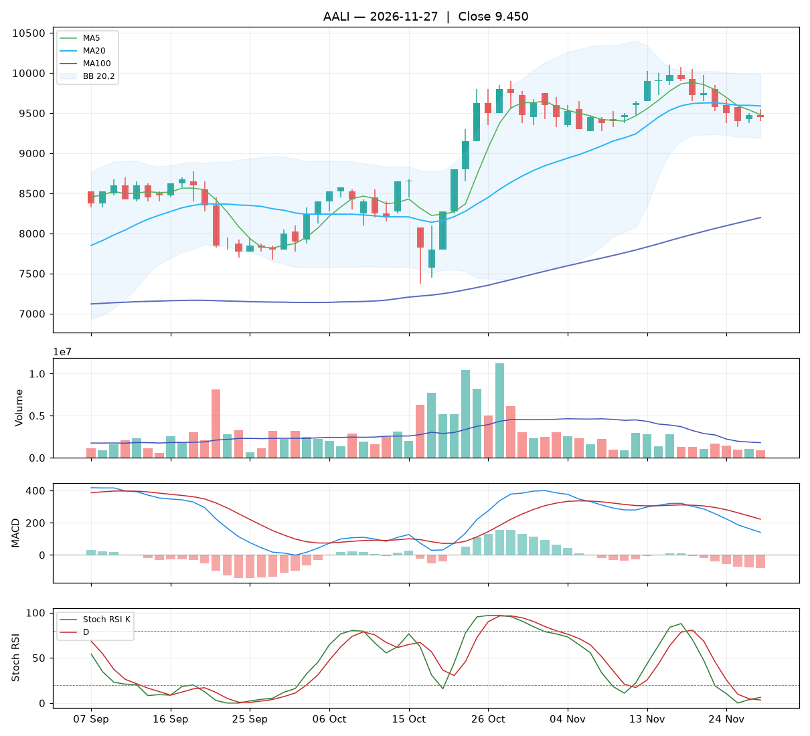

# Analisa harian AALI — 2026-11-27

## Ringkasan

| Open | High | Low | Close | Perubahan | Volume |
|---|---|---|---|---|---|
| 9.475 | 9.550 | 9.400 | **9.450** | -25 (-0.26%) | 906.900 |

### ⚪ Keputusan teknikal: **TUNGGU** — nilai total **4.5/10**

Sinyal campur aduk. Belum ada alasan teknikal yang jelas untuk masuk.

| Aspek | Nilai | |
|---|---|---|
| Tren | **3.0**/10 | `███░░░░░░░` |
| Volume | **3.2**/10 | `███░░░░░░░` |
| Stochastic | **7.2**/10 | `███████░░░` |
| Momentum | **4.5**/10 | `████░░░░░░` |
| Candle | **4.8**/10 | `█████░░░░░` |

**Level harga (otomatis):**

- Support 20 hari: 9.275 · Resistance 20 hari: 10.100
- Batas rugi (stop loss): 8.978 (di bawah support atau −5%)
- Target 1: 9.589 · Target 2: 10.100
- Rasio untung : rugi ke target 1 = 0.29 : 1 (kurang menarik, idealnya ≥ 1,5)

## 1. Candlestick

Candle merah (ditutup turun). Badan 17% dari rentang hari ini, sumbu atas 50%, sumbu bawah 33%.

- Tidak ada pola candle khusus yang terdeteksi.

## 2. Volume

- Volume hari ini 906.900 lembar, rata-rata 20 hari 1.791.620 (**0.51x** rata-rata).
- Volume sepi: pergerakan hari ini kurang meyakinkan.
- 5 hari terakhir: volume candle hijau 17%, candle merah 83%.

## 3. Stochastic & Stoch RSI

- Stochastic (14,3,3): %K 18.5, %D 22.3, zona **jenuh jual (oversold)**.
- Stoch RSI (14,14,3,3): K 6.3, D 3.4, zona **oversold**.
- Stoch RSI K memotong D ke atas: momentum mulai menguat.

## 4. Tren (Moving Average)

Tren jangka pendek: **turun** (MA20 berubah -38 dalam 5 hari).
- Harga di bawah MA5 (9.480).
- Harga di bawah MA20 (9.589).
- Harga di atas MA100 (8.198).

## 5. Bollinger Bands

- Bollinger (20,2): atas 9.988, tengah 9.589, bawah 9.189. Posisi harga 33% dari pita bawah ke atas, lebar pita 8.3%.

## 6. MACD & RSI

- MACD (12,26,9): garis 140.60, sinyal 221.88, histogram -81.28.
- Histogram memburuk dibanding kemarin.
- RSI (14): 51.3.

## 7. Support & Resistance

- Support 20 hari (low terendah): 9.275.
- Resistance 20 hari (high tertinggi): 10.100.
- Resistance terdekat lain: MA20 9.589, MA100 8.198.

## 8. Fundamental (laporan keuangan)

**Nilai fundamental: 10.0/10 — Kuat** (terpisah dari keputusan teknikal; dipakai untuk menilai kualitas perusahaan jangka panjang).

| PER | PBV | ROE | DER | Margin laba | Pendapatan YoY | Laba YoY | Kapitalisasi |
|---|---|---|---|---|---|---|---|
| 7.9 | 0.75 | 9.9% | 0.00x | 7.6% | 13.9% | 89.6% | 18.19 T |

Laporan laba rugi per kuartal (miliar Rp):

| Periode | Pendapatan | Laba bersih |
|---|---|---|
| 2026-09-30 | 8455.3 | 806.1 |
| 2026-06-30 | 7757.2 | 725.5 |
| 2026-03-31 | 7501.8 | 373.4 |
| 2025-12-31 | 6535.9 | 401.6 |
| 2025-06-30 | 7422.8 | 425.1 |

| Kondisi | Poin |
|---|---|
| PER 7.9x: murah | +1.00 |
| PBV 0.75x: di bawah nilai buku | +0.75 |
| ROE 10%: cukup | +0.50 |
| DER 0.00x: utang rendah | +0.75 |
| Pendapatan tumbuh +14% YoY | +0.56 |
| Laba bersih tumbuh +90% YoY | +1.50 |

_Sumber: Yahoo Finance. Untuk keputusan penting, cocokkan dengan laporan resmi di idx.co.id._

## 9. Cara nilai teknikal dihitung

Setiap aspek mulai dari **5** (netral), lalu ditambah atau dikurangi poin di bawah ini, dan dibatasi 0–10. Nilai total = rata-rata berbobot.

**Tren: 3.0/10** (bobot 25%)

| Kondisi | Poin |
|---|---|
| Harga di bawah MA5 | -1.00 |
| Harga di bawah MA20 | -1.50 |
| Harga di atas MA100 | +1.50 |
| MA20 menurun dalam 5 hari | -1.00 |

**Volume: 3.2/10** (bobot 20%)

| Kondisi | Poin |
|---|---|
| Harga turun dengan volume 0.51x rata-rata 20 hari | -0.51 |
| Volume hijau 5 hari 17% (akumulasi vs distribusi) | -1.31 |

**Stochastic: 7.2/10** (bobot 20%)

| Kondisi | Poin |
|---|---|
| Stochastic: K di bawah D | -0.75 |
| Stochastic oversold (19): peluang pantulan | +0.75 |
| Stoch RSI: K memotong D ke atas | +1.50 |
| Stoch RSI oversold (6): peluang pantulan | +0.75 |

**Momentum: 4.5/10** (bobot 20%)

| Kondisi | Poin |
|---|---|
| MACD di bawah garis sinyal | -1.50 |
| MACD di atas nol | +1.00 |
| Histogram MACD memburuk | -1.00 |
| RSI 51 di zona kuat (50–70) | +1.00 |

**Candle: 4.8/10** (bobot 15%)

| Kondisi | Poin |
|---|---|
| Badan candle merah 17% dari rentang | -0.25 |

_Laporan ini dibuat otomatis dari aturan teknikal sederhana. Bukan rekomendasi beli atau jual; selalu kombinasikan dengan analisa sendiri dan manajemen risiko._
