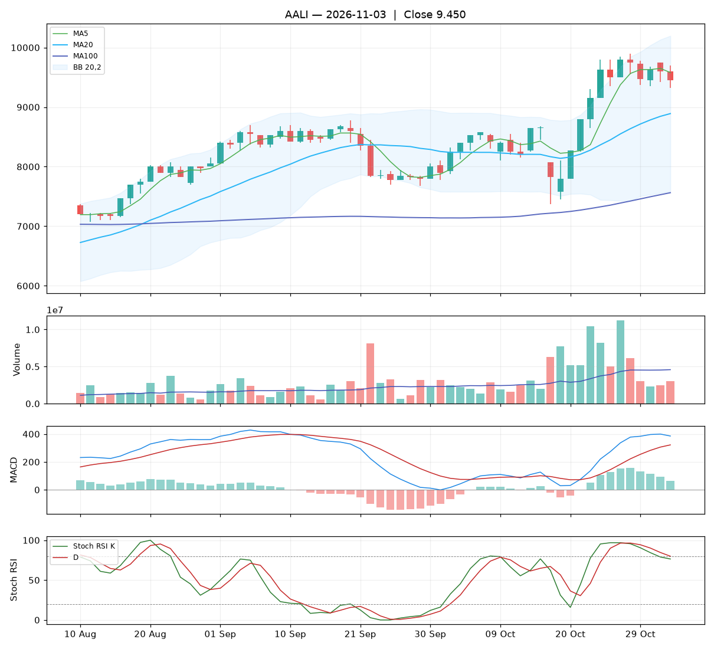

# Analisa harian AALI — 2026-11-03

## Ringkasan

| Open | High | Low | Close | Perubahan | Volume |
|---|---|---|---|---|---|
| 9.600 | 9.700 | 9.325 | **9.450** | -150 (-1.56%) | 3.066.800 |

### ⚪ Keputusan teknikal: **TUNGGU** — nilai total **5.3/10**

Sinyal campur aduk. Belum ada alasan teknikal yang jelas untuk masuk.

| Aspek | Nilai | |
|---|---|---|
| Tren | **8.0**/10 | `████████░░` |
| Volume | **2.9**/10 | `███░░░░░░░` |
| Stochastic | **2.8**/10 | `███░░░░░░░` |
| Momentum | **7.5**/10 | `████████░░` |
| Candle | **4.4**/10 | `████░░░░░░` |

**Level harga (otomatis):**

- Support 20 hari: 7.375 · Resistance 20 hari: 9.900
- Batas rugi (stop loss): 7.375 (di bawah support atau −5%)
- Target 1: 9.900 · Target 2: 10.196
- Rasio untung : rugi ke target 1 = 0.22 : 1 (kurang menarik, idealnya ≥ 1,5)

## 1. Candlestick

Candle merah (ditutup turun). Badan 40% dari rentang hari ini, sumbu atas 27%, sumbu bawah 33%.

- Tidak ada pola candle khusus yang terdeteksi.

## 2. Volume

- Volume hari ini 3.066.800 lembar, rata-rata 20 hari 4.582.295 (**0.67x** rata-rata).
- Volume sepi: pergerakan hari ini kurang meyakinkan.
- 5 hari terakhir: volume candle hijau 14%, candle merah 86%.

## 3. Stochastic & Stoch RSI

- Stochastic (14,3,3): %K 86.5, %D 87.3, zona **jenuh beli (overbought)**.
- Stoch RSI (14,14,3,3): K 76.5, D 79.9, zona **tengah**.
- K di bawah D: momentum masih turun.

## 4. Tren (Moving Average)

Tren jangka pendek: **naik** (MA20 berubah 341 dalam 5 hari).
- Harga di bawah MA5 (9.580).
- Harga di atas MA20 (8.891).
- Harga di atas MA100 (7.563).

## 5. Bollinger Bands

- Bollinger (20,2): atas 10.196, tengah 8.891, bawah 7.586. Posisi harga 71% dari pita bawah ke atas, lebar pita 29.4%.

## 6. MACD & RSI

- MACD (12,26,9): garis 385.74, sinyal 322.13, histogram 63.61.
- Histogram memburuk dibanding kemarin.
- RSI (14): 60.7.

## 7. Support & Resistance

- Support 20 hari (low terendah): 7.375.
- Resistance 20 hari (high tertinggi): 9.900.
- Resistance terdekat lain: MA20 8.891, MA100 7.563.

## 8. Fundamental (laporan keuangan)

**Nilai fundamental: 10.0/10 — Kuat** (terpisah dari keputusan teknikal; dipakai untuk menilai kualitas perusahaan jangka panjang).

| PER | PBV | ROE | DER | Margin laba | Pendapatan YoY | Laba YoY | Kapitalisasi |
|---|---|---|---|---|---|---|---|
| 7.9 | 0.75 | 9.9% | 0.00x | 7.6% | 13.9% | 89.6% | 18.19 T |

Laporan laba rugi per kuartal (miliar Rp):

| Periode | Pendapatan | Laba bersih |
|---|---|---|
| 2026-09-30 | 8455.3 | 806.1 |
| 2026-06-30 | 7757.2 | 725.5 |
| 2026-03-31 | 7501.8 | 373.4 |
| 2025-12-31 | 6535.9 | 401.6 |
| 2025-06-30 | 7422.8 | 425.1 |

| Kondisi | Poin |
|---|---|
| PER 7.9x: murah | +1.00 |
| PBV 0.75x: di bawah nilai buku | +0.75 |
| ROE 10%: cukup | +0.50 |
| DER 0.00x: utang rendah | +0.75 |
| Pendapatan tumbuh +14% YoY | +0.56 |
| Laba bersih tumbuh +90% YoY | +1.50 |

_Sumber: Yahoo Finance. Untuk keputusan penting, cocokkan dengan laporan resmi di idx.co.id._

## 9. Cara nilai teknikal dihitung

Setiap aspek mulai dari **5** (netral), lalu ditambah atau dikurangi poin di bawah ini, dan dibatasi 0–10. Nilai total = rata-rata berbobot.

**Tren: 8.0/10** (bobot 25%)

| Kondisi | Poin |
|---|---|
| Harga di bawah MA5 | -1.00 |
| Harga di atas MA20 | +1.50 |
| Harga di atas MA100 | +1.50 |
| MA20 menanjak dalam 5 hari | +1.00 |

**Volume: 2.9/10** (bobot 20%)

| Kondisi | Poin |
|---|---|
| Harga turun dengan volume 0.67x rata-rata 20 hari | -0.67 |
| Volume hijau 5 hari 14% (akumulasi vs distribusi) | -1.45 |

**Stochastic: 2.8/10** (bobot 20%)

| Kondisi | Poin |
|---|---|
| Stochastic: K di bawah D | -0.75 |
| Stochastic overbought (86): rawan koreksi | -0.75 |
| Stoch RSI: K di bawah D | -0.75 |

**Momentum: 7.5/10** (bobot 20%)

| Kondisi | Poin |
|---|---|
| MACD di atas garis sinyal | +1.50 |
| MACD di atas nol | +1.00 |
| Histogram MACD memburuk | -1.00 |
| RSI 61 di zona kuat (50–70) | +1.00 |

**Candle: 4.4/10** (bobot 15%)

| Kondisi | Poin |
|---|---|
| Badan candle merah 40% dari rentang | -0.60 |

_Laporan ini dibuat otomatis dari aturan teknikal sederhana. Bukan rekomendasi beli atau jual; selalu kombinasikan dengan analisa sendiri dan manajemen risiko._
