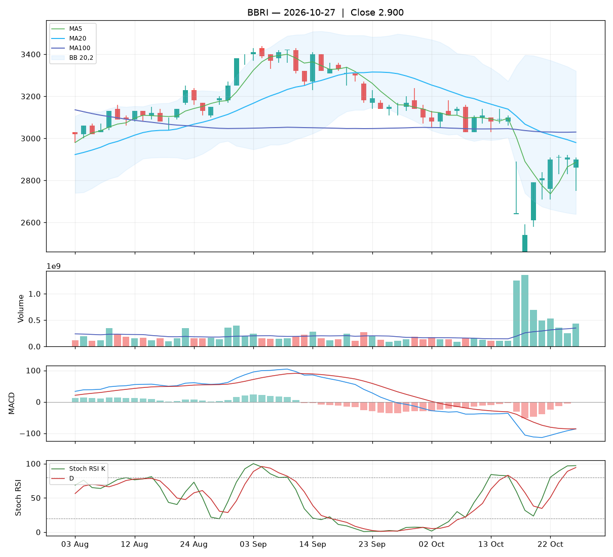

# Analisa harian BBRI — 2026-10-27

## Ringkasan

| Open | High | Low | Close | Perubahan | Volume |
|---|---|---|---|---|---|
| 2.860 | 2.910 | 2.750 | **2.900** | -10 (-0.34%) | 431.627.300 |

### ⚪ Keputusan teknikal: **TUNGGU** — nilai total **4.6/10**

Sinyal campur aduk. Belum ada alasan teknikal yang jelas untuk masuk.

| Aspek | Nilai | |
|---|---|---|
| Tren | **2.0**/10 | `██░░░░░░░░` |
| Volume | **5.8**/10 | `██████░░░░` |
| Stochastic | **5.8**/10 | `██████░░░░` |
| Momentum | **3.0**/10 | `███░░░░░░░` |
| Candle | **7.9**/10 | `████████░░` |

**Level harga (otomatis):**

- Support 20 hari: 2.460 · Resistance 20 hari: 3.240
- Batas rugi (stop loss): 2.460 (di bawah support atau −5%)
- Target 1: 2.980 · Target 2: 3.240
- Rasio untung : rugi ke target 1 = 0.18 : 1 (kurang menarik, idealnya ≥ 1,5)

## 1. Candlestick

Candle hijau (ditutup naik). Badan 25% dari rentang hari ini, sumbu atas 6%, sumbu bawah 69%.

- 🟢 **Hammer** — Sumbu bawah panjang setelah tren turun: ada penolakan harga rendah, potensi pembalikan naik.

## 2. Volume

- Volume hari ini 431.627.300 lembar, rata-rata 20 hari 349.054.975 (**1.24x** rata-rata).
- Volume normal.
- 5 hari terakhir: volume candle hijau 100%, candle merah 0%.

## 3. Stochastic & Stoch RSI

- Stochastic (14,3,3): %K 63.2, %D 61.1, zona **tengah**.
- Stoch RSI (14,14,3,3): K 97.1, D 94.3, zona **overbought**.
- K di atas D: momentum masih naik.

## 4. Tren (Moving Average)

Tren jangka pendek: **turun** (MA20 berubah -68 dalam 5 hari).
- Harga di atas MA5 (2.886).
- Harga di bawah MA20 (2.980).
- Harga di bawah MA100 (3.030).

## 5. Bollinger Bands

- Bollinger (20,2): atas 3.320, tengah 2.980, bawah 2.640. Posisi harga 38% dari pita bawah ke atas, lebar pita 22.8%.

## 6. MACD & RSI

- MACD (12,26,9): garis -86.31, sinyal -86.17, histogram -0.14.
- Histogram membaik dibanding kemarin: tekanan turun berkurang / tekanan naik bertambah.
- MACD masih di bawah nol: tren menengah masih lemah.
- RSI (14): 43.8.

## 7. Support & Resistance

- Support 20 hari (low terendah): 2.460.
- Resistance 20 hari (high tertinggi): 3.240.
- Resistance terdekat lain: MA20 2.980, MA100 3.030.

## 8. Fundamental (laporan keuangan)

**Nilai fundamental: 8.5/10 — Kuat** (terpisah dari keputusan teknikal; dipakai untuk menilai kualitas perusahaan jangka panjang).

| PER | PBV | ROE | DER | Margin laba | Pendapatan YoY | Laba YoY | Kapitalisasi |
|---|---|---|---|---|---|---|---|
| 7.1 | 1.36 | 19.0% | 0.69x | 41.7% | 8.8% | 12.9% | 436.98 T |

Laporan laba rugi per kuartal (miliar Rp):

| Periode | Pendapatan | Laba bersih |
|---|---|---|
| 2026-06-30 | 48719.1 | 15372.7 |
| 2026-03-31 | 49615.9 | 15492.7 |
| 2025-12-31 | 50553.2 | 15873.6 |
| 2025-06-30 | 44774.5 | 12603.5 |
| 2025-03-31 | 44772.2 | 13621.5 |

| Kondisi | Poin |
|---|---|
| PER 7.1x: murah | +1.00 |
| ROE 19%: sangat efisien | +1.25 |
| Margin laba bersih 42%: sehat | +0.50 |
| Pendapatan tumbuh +9% YoY | +0.35 |
| Laba bersih tumbuh +13% YoY | +0.39 |

_Sumber: Yahoo Finance. Untuk keputusan penting, cocokkan dengan laporan resmi di idx.co.id._

## 9. Cara nilai teknikal dihitung

Setiap aspek mulai dari **5** (netral), lalu ditambah atau dikurangi poin di bawah ini, dan dibatasi 0–10. Nilai total = rata-rata berbobot.

**Tren: 2.0/10** (bobot 25%)

| Kondisi | Poin |
|---|---|
| Harga di atas MA5 | +1.00 |
| Harga di bawah MA20 | -1.50 |
| Harga di bawah MA100 | -1.50 |
| MA20 menurun dalam 5 hari | -1.00 |

**Volume: 5.8/10** (bobot 20%)

| Kondisi | Poin |
|---|---|
| Harga turun dengan volume 1.24x rata-rata 20 hari | -1.24 |
| Volume hijau 5 hari 100% (akumulasi vs distribusi) | +2.00 |

**Stochastic: 5.8/10** (bobot 20%)

| Kondisi | Poin |
|---|---|
| Stochastic: K di atas D | +0.75 |
| Stoch RSI: K di atas D | +0.75 |
| Stoch RSI overbought (97): rawan koreksi | -0.75 |

**Momentum: 3.0/10** (bobot 20%)

| Kondisi | Poin |
|---|---|
| MACD di bawah garis sinyal | -1.50 |
| MACD di bawah nol | -1.00 |
| Histogram MACD membaik | +1.00 |
| RSI 44 di zona lemah (30–50) | -0.50 |

**Candle: 7.9/10** (bobot 15%)

| Kondisi | Poin |
|---|---|
| Badan candle hijau 25% dari rentang | +0.38 |
| Sumbu bawah lebih panjang: ada penolakan harga rendah | +0.50 |
| Pola Hammer | +2.00 |

_Laporan ini dibuat otomatis dari aturan teknikal sederhana. Bukan rekomendasi beli atau jual; selalu kombinasikan dengan analisa sendiri dan manajemen risiko._
