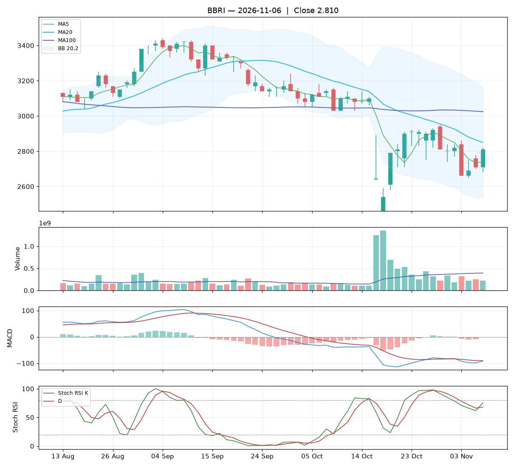

# Analisa harian BBRI — 2026-11-06

## Ringkasan

| Open | High | Low | Close | Perubahan | Volume |
|---|---|---|---|---|---|
| 2.710 | 2.820 | 2.680 | **2.810** | +100 (+3.69%) | 217.901.500 |

### ⚪ Keputusan teknikal: **TUNGGU** — nilai total **5.0/10**

Sinyal campur aduk. Belum ada alasan teknikal yang jelas untuk masuk.

| Aspek | Nilai | |
|---|---|---|
| Tren | **2.0**/10 | `██░░░░░░░░` |
| Volume | **5.6**/10 | `██████░░░░` |
| Stochastic | **8.0**/10 | `████████░░` |
| Momentum | **3.0**/10 | `███░░░░░░░` |
| Candle | **8.1**/10 | `████████░░` |

**Level harga (otomatis):**

- Support 20 hari: 2.460 · Resistance 20 hari: 3.140
- Batas rugi (stop loss): 2.460 (di bawah support atau −5%)
- Target 1: 2.850 · Target 2: 3.140
- Rasio untung : rugi ke target 1 = 0.11 : 1 (kurang menarik, idealnya ≥ 1,5)

## 1. Candlestick

Candle hijau (ditutup naik). Badan 71% dari rentang hari ini, sumbu atas 7%, sumbu bawah 21%.

- 🟢 **Bullish engulfing** — Badan hijau menelan badan merah sebelumnya: pembeli mengambil alih.

## 2. Volume

- Volume hari ini 217.901.500 lembar, rata-rata 20 hari 393.979.665 (**0.55x** rata-rata).
- Volume sepi: pergerakan hari ini kurang meyakinkan.
- 5 hari terakhir: volume candle hijau 52%, candle merah 48%.

## 3. Stochastic & Stoch RSI

- Stochastic (14,3,3): %K 53.4, %D 46.6, zona **tengah**.
- %K memotong %D ke atas.
- Stoch RSI (14,14,3,3): K 75.4, D 67.8, zona **tengah**.
- Stoch RSI K memotong D ke atas: momentum mulai menguat.

## 4. Tren (Moving Average)

Tren jangka pendek: **turun** (MA20 berubah -90 dalam 5 hari).
- Harga di atas MA5 (2.738).
- Harga di bawah MA20 (2.850).
- Harga di bawah MA100 (3.024).

## 5. Bollinger Bands

- Bollinger (20,2): atas 3.163, tengah 2.850, bawah 2.537. Posisi harga 44% dari pita bawah ke atas, lebar pita 22.0%.

## 6. MACD & RSI

- MACD (12,26,9): garis -91.01, sinyal -90.32, histogram -0.70.
- Histogram membaik dibanding kemarin: tekanan turun berkurang / tekanan naik bertambah.
- MACD masih di bawah nol: tren menengah masih lemah.
- RSI (14): 44.5.

## 7. Support & Resistance

- Support 20 hari (low terendah): 2.460.
- Resistance 20 hari (high tertinggi): 3.140.
- Resistance terdekat lain: MA20 2.850, MA100 3.024.

## 8. Fundamental (laporan keuangan)

**Nilai fundamental: 8.5/10 — Kuat** (terpisah dari keputusan teknikal; dipakai untuk menilai kualitas perusahaan jangka panjang).

| PER | PBV | ROE | DER | Margin laba | Pendapatan YoY | Laba YoY | Kapitalisasi |
|---|---|---|---|---|---|---|---|
| 6.9 | 1.32 | 19.0% | 0.69x | 41.7% | 8.8% | 12.9% | 423.12 T |

Laporan laba rugi per kuartal (miliar Rp):

| Periode | Pendapatan | Laba bersih |
|---|---|---|
| 2026-06-30 | 48719.1 | 15372.7 |
| 2026-03-31 | 49615.9 | 15492.7 |
| 2025-12-31 | 50553.2 | 15873.6 |
| 2025-06-30 | 44774.5 | 12603.5 |
| 2025-03-31 | 44772.2 | 13621.5 |

| Kondisi | Poin |
|---|---|
| PER 6.9x: murah | +1.00 |
| ROE 19%: sangat efisien | +1.25 |
| Margin laba bersih 42%: sehat | +0.50 |
| Pendapatan tumbuh +9% YoY | +0.35 |
| Laba bersih tumbuh +13% YoY | +0.39 |

_Sumber: Yahoo Finance. Untuk keputusan penting, cocokkan dengan laporan resmi di idx.co.id._

## 9. Cara nilai teknikal dihitung

Setiap aspek mulai dari **5** (netral), lalu ditambah atau dikurangi poin di bawah ini, dan dibatasi 0–10. Nilai total = rata-rata berbobot.

**Tren: 2.0/10** (bobot 25%)

| Kondisi | Poin |
|---|---|
| Harga di atas MA5 | +1.00 |
| Harga di bawah MA20 | -1.50 |
| Harga di bawah MA100 | -1.50 |
| MA20 menurun dalam 5 hari | -1.00 |

**Volume: 5.6/10** (bobot 20%)

| Kondisi | Poin |
|---|---|
| Harga naik dengan volume 0.55x rata-rata 20 hari | +0.55 |
| Volume hijau 5 hari 52% (akumulasi vs distribusi) | +0.09 |

**Stochastic: 8.0/10** (bobot 20%)

| Kondisi | Poin |
|---|---|
| Stochastic: K memotong D ke atas | +1.50 |
| Stoch RSI: K memotong D ke atas | +1.50 |

**Momentum: 3.0/10** (bobot 20%)

| Kondisi | Poin |
|---|---|
| MACD di bawah garis sinyal | -1.50 |
| MACD di bawah nol | -1.00 |
| Histogram MACD membaik | +1.00 |
| RSI 45 di zona lemah (30–50) | -0.50 |

**Candle: 8.1/10** (bobot 15%)

| Kondisi | Poin |
|---|---|
| Badan candle hijau 71% dari rentang | +1.07 |
| Pola Bullish engulfing | +2.00 |

_Laporan ini dibuat otomatis dari aturan teknikal sederhana. Bukan rekomendasi beli atau jual; selalu kombinasikan dengan analisa sendiri dan manajemen risiko._
