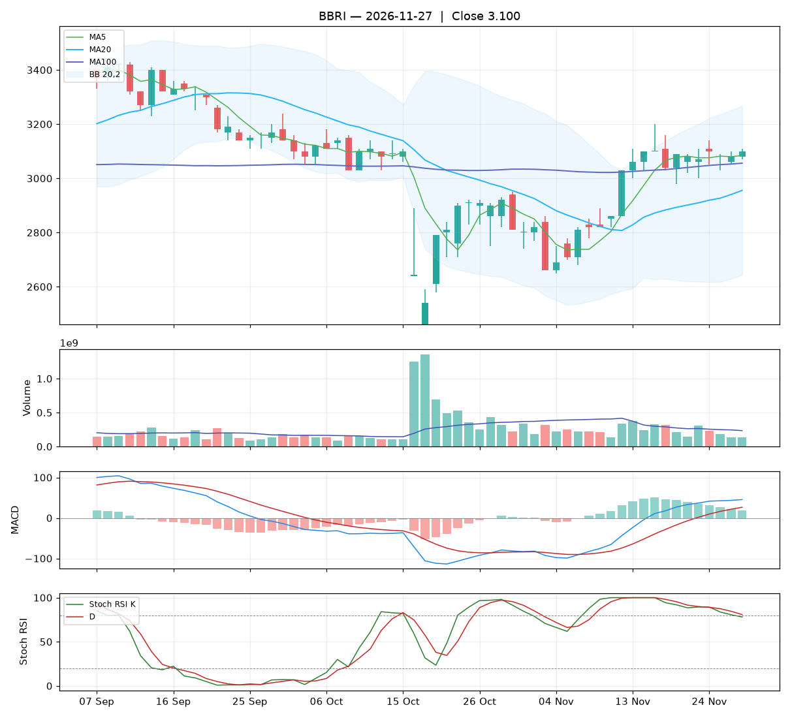

# Analisa harian BBRI — 2026-11-27

## Ringkasan

| Open | High | Low | Close | Perubahan | Volume |
|---|---|---|---|---|---|
| 3.080 | 3.110 | 3.070 | **3.100** | +20 (+0.65%) | 132.941.000 |

### 🟡 Keputusan teknikal: **PANTAU** — nilai total **6.8/10**

Cukup positif, tetapi belum kuat. Tunggu konfirmasi candle/volume berikutnya.

| Aspek | Nilai | |
|---|---|---|
| Tren | **10.0**/10 | `██████████` |
| Volume | **6.4**/10 | `██████░░░░` |
| Stochastic | **3.5**/10 | `████░░░░░░` |
| Momentum | **7.5**/10 | `████████░░` |
| Candle | **5.8**/10 | `██████░░░░` |

**Level harga (otomatis):**

- Support 20 hari: 2.650 · Resistance 20 hari: 3.200
- Batas rugi (stop loss): 2.650 (di bawah support atau −5%)
- Target 1: 3.200 · Target 2: 3.267
- Rasio untung : rugi ke target 1 = 0.22 : 1 (kurang menarik, idealnya ≥ 1,5)

## 1. Candlestick

Candle hijau (ditutup naik). Badan 50% dari rentang hari ini, sumbu atas 25%, sumbu bawah 25%.

- Tidak ada pola candle khusus yang terdeteksi.

## 2. Volume

- Volume hari ini 132.941.000 lembar, rata-rata 20 hari 234.277.330 (**0.57x** rata-rata).
- Volume sepi: pergerakan hari ini kurang meyakinkan.
- 5 hari terakhir: volume candle hijau 71%, candle merah 29%.

## 3. Stochastic & Stoch RSI

- Stochastic (14,3,3): %K 73.4, %D 75.5, zona **tengah**.
- Stoch RSI (14,14,3,3): K 78.1, D 80.8, zona **tengah**.
- K di bawah D: momentum masih turun.

## 4. Tren (Moving Average)

Tren jangka pendek: **naik** (MA20 berubah 54 dalam 5 hari).
- Harga di atas MA5 (3.084).
- Harga di atas MA20 (2.956).
- Harga di atas MA100 (3.056).

## 5. Bollinger Bands

- Bollinger (20,2): atas 3.267, tengah 2.956, bawah 2.644. Posisi harga 73% dari pita bawah ke atas, lebar pita 21.1%.

## 6. MACD & RSI

- MACD (12,26,9): garis 45.37, sinyal 26.42, histogram 18.95.
- Histogram memburuk dibanding kemarin.
- RSI (14): 59.4.

## 7. Support & Resistance

- Support 20 hari (low terendah): 2.650.
- Resistance 20 hari (high tertinggi): 3.200.
- Resistance terdekat lain: MA20 2.956, MA100 3.056.

## 8. Fundamental (laporan keuangan)

**Nilai fundamental: 9.0/10 — Kuat** (terpisah dari keputusan teknikal; dipakai untuk menilai kualitas perusahaan jangka panjang).

| PER | PBV | ROE | DER | Margin laba | Pendapatan YoY | Laba YoY | Kapitalisasi |
|---|---|---|---|---|---|---|---|
| 7.3 | 1.38 | 18.7% | 0.60x | 42.8% | 5.4% | 33.5% | 467.09 T |

Laporan laba rugi per kuartal (miliar Rp):

| Periode | Pendapatan | Laba bersih |
|---|---|---|
| 2026-09-30 | 47177.6 | 16823.6 |
| 2026-06-30 | 48719.1 | 15372.7 |
| 2026-03-31 | 49615.9 | 15492.7 |
| 2025-12-31 | 50553.2 | 15873.6 |
| 2025-06-30 | 44774.5 | 12603.5 |

| Kondisi | Poin |
|---|---|
| PER 7.3x: murah | +1.00 |
| ROE 19%: sangat efisien | +1.25 |
| Margin laba bersih 43%: sehat | +0.50 |
| Pendapatan tumbuh +5% YoY | +0.21 |
| Laba bersih tumbuh +33% YoY | +1.00 |

_Sumber: Yahoo Finance. Untuk keputusan penting, cocokkan dengan laporan resmi di idx.co.id._

## 9. Cara nilai teknikal dihitung

Setiap aspek mulai dari **5** (netral), lalu ditambah atau dikurangi poin di bawah ini, dan dibatasi 0–10. Nilai total = rata-rata berbobot.

**Tren: 10.0/10** (bobot 25%)

| Kondisi | Poin |
|---|---|
| Harga di atas MA5 | +1.00 |
| Harga di atas MA20 | +1.50 |
| Harga di atas MA100 | +1.50 |
| MA20 menanjak dalam 5 hari | +1.00 |

**Volume: 6.4/10** (bobot 20%)

| Kondisi | Poin |
|---|---|
| Harga naik dengan volume 0.57x rata-rata 20 hari | +0.57 |
| Volume hijau 5 hari 71% (akumulasi vs distribusi) | +0.84 |

**Stochastic: 3.5/10** (bobot 20%)

| Kondisi | Poin |
|---|---|
| Stochastic: K di bawah D | -0.75 |
| Stoch RSI: K di bawah D | -0.75 |

**Momentum: 7.5/10** (bobot 20%)

| Kondisi | Poin |
|---|---|
| MACD di atas garis sinyal | +1.50 |
| MACD di atas nol | +1.00 |
| Histogram MACD memburuk | -1.00 |
| RSI 59 di zona kuat (50–70) | +1.00 |

**Candle: 5.8/10** (bobot 15%)

| Kondisi | Poin |
|---|---|
| Badan candle hijau 50% dari rentang | +0.75 |

_Laporan ini dibuat otomatis dari aturan teknikal sederhana. Bukan rekomendasi beli atau jual; selalu kombinasikan dengan analisa sendiri dan manajemen risiko._
