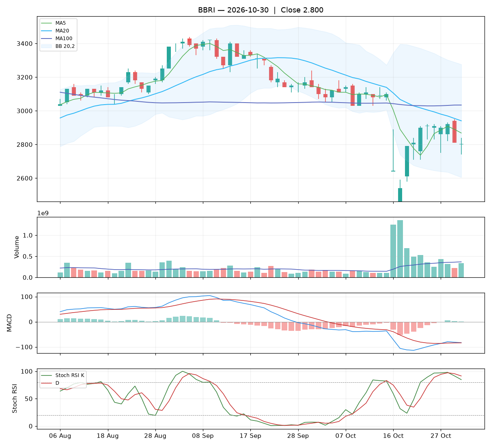

# Analisa harian BBRI — 2026-10-30

## Ringkasan

| Open | High | Low | Close | Perubahan | Volume |
|---|---|---|---|---|---|
| 2.800 | 2.840 | 2.740 | **2.800** | -10 (-0.36%) | 332.954.600 |

### 🔴 Keputusan teknikal: **HINDARI** — nilai total **3.2/10**

Mayoritas indikator searah turun. Bagi yang memegang, pertimbangkan batas rugi.

| Aspek | Nilai | |
|---|---|---|
| Tren | **0.0**/10 | `░░░░░░░░░░` |
| Volume | **5.4**/10 | `█████░░░░░` |
| Stochastic | **2.8**/10 | `███░░░░░░░` |
| Momentum | **4.0**/10 | `████░░░░░░` |
| Candle | **5.0**/10 | `█████░░░░░` |

**Level harga (otomatis):**

- Support 20 hari: 2.460 · Resistance 20 hari: 3.180
- Batas rugi (stop loss): 2.460 (di bawah support atau −5%)
- Target 1: 2.940 · Target 2: 3.180
- Rasio untung : rugi ke target 1 = 0.41 : 1 (kurang menarik, idealnya ≥ 1,5)

## 1. Candlestick

Candle netral. Badan 0% dari rentang hari ini, sumbu atas 40%, sumbu bawah 60%.

- ⚪ **Doji** — Badan sangat kecil: pasar ragu, kekuatan beli dan jual seimbang.

## 2. Volume

- Volume hari ini 332.954.600 lembar, rata-rata 20 hari 368.483.695 (**0.90x** rata-rata).
- Volume normal.
- 5 hari terakhir: volume candle hijau 82%, candle merah 18%.

## 3. Stochastic & Stoch RSI

- Stochastic (14,3,3): %K 56.4, %D 60.7, zona **tengah**.
- Stoch RSI (14,14,3,3): K 84.7, D 91.4, zona **overbought**.
- K di bawah D: momentum masih turun.

## 4. Tren (Moving Average)

Tren jangka pendek: **turun** (MA20 berubah -64 dalam 5 hari).
- Harga di bawah MA5 (2.868).
- Harga di bawah MA20 (2.940).
- Harga di bawah MA100 (3.034).

## 5. Bollinger Bands

- Bollinger (20,2): atas 3.276, tengah 2.940, bawah 2.605. Posisi harga 29% dari pita bawah ke atas, lebar pita 22.8%.

## 6. MACD & RSI

- MACD (12,26,9): garis -83.19, sinyal -83.94, histogram 0.75.
- Histogram memburuk dibanding kemarin.
- MACD masih di bawah nol: tren menengah masih lemah.
- RSI (14): 39.2.

## 7. Support & Resistance

- Support 20 hari (low terendah): 2.460.
- Resistance 20 hari (high tertinggi): 3.180.
- Resistance terdekat lain: MA20 2.940, MA100 3.034.

## 8. Fundamental (laporan keuangan)

**Nilai fundamental: 8.5/10 — Kuat** (terpisah dari keputusan teknikal; dipakai untuk menilai kualitas perusahaan jangka panjang).

| PER | PBV | ROE | DER | Margin laba | Pendapatan YoY | Laba YoY | Kapitalisasi |
|---|---|---|---|---|---|---|---|
| 6.9 | 1.31 | 19.0% | 0.69x | 41.7% | 8.8% | 12.9% | 421.92 T |

Laporan laba rugi per kuartal (miliar Rp):

| Periode | Pendapatan | Laba bersih |
|---|---|---|
| 2026-06-30 | 48719.1 | 15372.7 |
| 2026-03-31 | 49615.9 | 15492.7 |
| 2025-12-31 | 50553.2 | 15873.6 |
| 2025-06-30 | 44774.5 | 12603.5 |
| 2025-03-31 | 44772.2 | 13621.5 |

| Kondisi | Poin |
|---|---|
| PER 6.9x: murah | +1.00 |
| ROE 19%: sangat efisien | +1.25 |
| Margin laba bersih 42%: sehat | +0.50 |
| Pendapatan tumbuh +9% YoY | +0.35 |
| Laba bersih tumbuh +13% YoY | +0.39 |

_Sumber: Yahoo Finance. Untuk keputusan penting, cocokkan dengan laporan resmi di idx.co.id._

## 9. Cara nilai teknikal dihitung

Setiap aspek mulai dari **5** (netral), lalu ditambah atau dikurangi poin di bawah ini, dan dibatasi 0–10. Nilai total = rata-rata berbobot.

**Tren: 0.0/10** (bobot 25%)

| Kondisi | Poin |
|---|---|
| Harga di bawah MA5 | -1.00 |
| Harga di bawah MA20 | -1.50 |
| Harga di bawah MA100 | -1.50 |
| MA20 menurun dalam 5 hari | -1.00 |

**Volume: 5.4/10** (bobot 20%)

| Kondisi | Poin |
|---|---|
| Harga turun dengan volume 0.90x rata-rata 20 hari | -0.90 |
| Volume hijau 5 hari 82% (akumulasi vs distribusi) | +1.27 |

**Stochastic: 2.8/10** (bobot 20%)

| Kondisi | Poin |
|---|---|
| Stochastic: K di bawah D | -0.75 |
| Stoch RSI: K di bawah D | -0.75 |
| Stoch RSI overbought (85): rawan koreksi | -0.75 |

**Momentum: 4.0/10** (bobot 20%)

| Kondisi | Poin |
|---|---|
| MACD di atas garis sinyal | +1.50 |
| MACD di bawah nol | -1.00 |
| Histogram MACD memburuk | -1.00 |
| RSI 39 di zona lemah (30–50) | -0.50 |

**Candle: 5.0/10** (bobot 15%)

| Kondisi | Poin |
|---|---|
| Badan candle netral 0% dari rentang | +0.00 |

_Laporan ini dibuat otomatis dari aturan teknikal sederhana. Bukan rekomendasi beli atau jual; selalu kombinasikan dengan analisa sendiri dan manajemen risiko._
