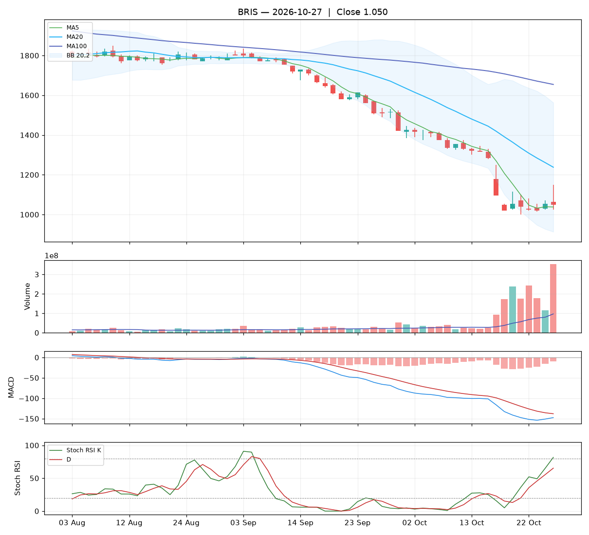

# Analisa harian BRIS — 2026-10-27

## Ringkasan

| Open | High | Low | Close | Perubahan | Volume |
|---|---|---|---|---|---|
| 1.065 | 1.150 | 1.025 | **1.050** | -5 (-0.47%) | 354.285.800 |

### 🔴 Keputusan teknikal: **HINDARI** — nilai total **3.3/10**

Mayoritas indikator searah turun. Bagi yang memegang, pertimbangkan batas rugi.

| Aspek | Nilai | |
|---|---|---|
| Tren | **2.0**/10 | `██░░░░░░░░` |
| Volume | **0.4**/10 | `░░░░░░░░░░` |
| Stochastic | **6.5**/10 | `██████░░░░` |
| Momentum | **4.0**/10 | `████░░░░░░` |
| Candle | **4.3**/10 | `████░░░░░░` |

**Level harga (otomatis):**

- Support 20 hari: 1.000 · Resistance 20 hari: 1.525
- Batas rugi (stop loss): 998 (di bawah support atau −5%)
- Target 1: 1.238 · Target 2: 1.525
- Rasio untung : rugi ke target 1 = 3.58 : 1

## 1. Candlestick

Candle merah (ditutup turun). Badan 12% dari rentang hari ini, sumbu atas 68%, sumbu bawah 20%.

- Tidak ada pola candle khusus yang terdeteksi.

## 2. Volume

- Volume hari ini 354.285.800 lembar, rata-rata 20 hari 96.815.455 (**3.66x** rata-rata).
- Volume tinggi saat harga turun: tekanan jual kuat (distribusi).
- 5 hari terakhir: volume candle hijau 11%, candle merah 89%.

## 3. Stochastic & Stoch RSI

- Stochastic (14,3,3): %K 10.3, %D 8.3, zona **jenuh jual (oversold)**.
- Stoch RSI (14,14,3,3): K 81.7, D 65.3, zona **overbought**.
- K di atas D: momentum masih naik.

## 4. Tren (Moving Average)

Tren jangka pendek: **turun** (MA20 berubah -126 dalam 5 hari).
- Harga di atas MA5 (1.038).
- Harga di bawah MA20 (1.238).
- Harga di bawah MA100 (1.654).

## 5. Bollinger Bands

- Bollinger (20,2): atas 1.563, tengah 1.238, bawah 913. Posisi harga 21% dari pita bawah ke atas, lebar pita 52.5%.

## 6. MACD & RSI

- MACD (12,26,9): garis -147.43, sinyal -137.95, histogram -9.48.
- Histogram membaik dibanding kemarin: tekanan turun berkurang / tekanan naik bertambah.
- MACD masih di bawah nol: tren menengah masih lemah.
- RSI (14): 19.6 — oversold.

## 7. Support & Resistance

- Support 20 hari (low terendah): 1.000.
- Resistance 20 hari (high tertinggi): 1.525.
- Resistance terdekat lain: MA20 1.238, MA100 1.654.

## 8. Fundamental (laporan keuangan)

**Nilai fundamental: 9.7/10 — Kuat** (terpisah dari keputusan teknikal; dipakai untuk menilai kualitas perusahaan jangka panjang).

| PER | PBV | ROE | DER | Margin laba | Pendapatan YoY | Laba YoY | Kapitalisasi |
|---|---|---|---|---|---|---|---|
| 6.1 | 0.95 | 16.1% | 0.18x | 31.5% | 7.2% | 4.1% | 48.44 T |

Laporan laba rugi per kuartal (miliar Rp):

| Periode | Pendapatan | Laba bersih |
|---|---|---|
| 2026-06-30 | 6271.7 | 1955.6 |
| 2026-03-31 | 6670.9 | 2200.1 |
| 2025-12-31 | 6625.2 | 1998.6 |
| 2025-06-30 | 5849.1 | 1862.4 |
| 2025-03-31 | - | 1878.8 |

| Kondisi | Poin |
|---|---|
| PER 6.1x: murah | +1.00 |
| PBV 0.95x: di bawah nilai buku | +0.75 |
| ROE 16%: sangat efisien | +1.25 |
| DER 0.18x: utang rendah | +0.75 |
| Margin laba bersih 32%: sehat | +0.50 |
| Pendapatan tumbuh +7% YoY | +0.29 |
| Laba bersih tumbuh +4% YoY | +0.12 |

_Sumber: Yahoo Finance. Untuk keputusan penting, cocokkan dengan laporan resmi di idx.co.id._

## 9. Cara nilai teknikal dihitung

Setiap aspek mulai dari **5** (netral), lalu ditambah atau dikurangi poin di bawah ini, dan dibatasi 0–10. Nilai total = rata-rata berbobot.

**Tren: 2.0/10** (bobot 25%)

| Kondisi | Poin |
|---|---|
| Harga di atas MA5 | +1.00 |
| Harga di bawah MA20 | -1.50 |
| Harga di bawah MA100 | -1.50 |
| MA20 menurun dalam 5 hari | -1.00 |

**Volume: 0.4/10** (bobot 20%)

| Kondisi | Poin |
|---|---|
| Harga turun dengan volume 3.66x rata-rata 20 hari | -3.00 |
| Volume hijau 5 hari 11% (akumulasi vs distribusi) | -1.57 |

**Stochastic: 6.5/10** (bobot 20%)

| Kondisi | Poin |
|---|---|
| Stochastic: K di atas D | +0.75 |
| Stochastic oversold (10): peluang pantulan | +0.75 |
| Stoch RSI: K di atas D | +0.75 |
| Stoch RSI overbought (82): rawan koreksi | -0.75 |

**Momentum: 4.0/10** (bobot 20%)

| Kondisi | Poin |
|---|---|
| MACD di bawah garis sinyal | -1.50 |
| MACD di bawah nol | -1.00 |
| Histogram MACD membaik | +1.00 |
| RSI 20 oversold, peluang pantulan | +0.50 |

**Candle: 4.3/10** (bobot 15%)

| Kondisi | Poin |
|---|---|
| Badan candle merah 12% dari rentang | -0.18 |
| Sumbu atas lebih panjang: ada penolakan harga tinggi | -0.50 |

_Laporan ini dibuat otomatis dari aturan teknikal sederhana. Bukan rekomendasi beli atau jual; selalu kombinasikan dengan analisa sendiri dan manajemen risiko._
