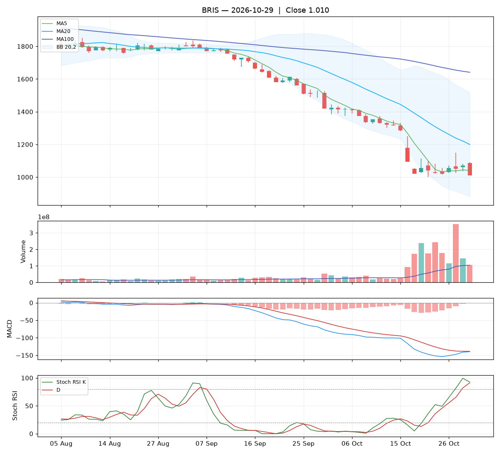

# Analisa harian BRIS — 2026-10-29

## Ringkasan

| Open | High | Low | Close | Perubahan | Volume |
|---|---|---|---|---|---|
| 1.085 | 1.090 | 1.010 | **1.010** | -60 (-5.61%) | 104.246.700 |

### 🔴 Keputusan teknikal: **HINDARI** — nilai total **2.3/10**

Mayoritas indikator searah turun. Bagi yang memegang, pertimbangkan batas rugi.

| Aspek | Nilai | |
|---|---|---|
| Tren | **0.0**/10 | `░░░░░░░░░░` |
| Volume | **3.2**/10 | `███░░░░░░░` |
| Stochastic | **4.2**/10 | `████░░░░░░` |
| Momentum | **4.0**/10 | `████░░░░░░` |
| Candle | **0.0**/10 | `░░░░░░░░░░` |

**Level harga (otomatis):**

- Support 20 hari: 1.000 · Resistance 20 hari: 1.435
- Batas rugi (stop loss): 960 (di bawah support atau −5%)
- Target 1: 1.200 · Target 2: 1.435
- Rasio untung : rugi ke target 1 = 3.76 : 1

## 1. Candlestick

Candle merah (ditutup turun). Badan 94% dari rentang hari ini, sumbu atas 6%, sumbu bawah 0%.

- 🔴 **Marubozu merah** — Hampir tanpa sumbu: penjual menguasai sepanjang hari.
- 🔴 **Bearish engulfing** — Badan merah menelan badan hijau sebelumnya: penjual mengambil alih.

## 2. Volume

- Volume hari ini 104.246.700 lembar, rata-rata 20 hari 104.399.010 (**1.00x** rata-rata).
- Volume normal.
- 5 hari terakhir: volume candle hijau 29%, candle merah 71%.

## 3. Stochastic & Stoch RSI

- Stochastic (14,3,3): %K 11.4, %D 12.2, zona **jenuh jual (oversold)**.
- %K memotong %D ke bawah.
- Stoch RSI (14,14,3,3): K 92.6, D 91.2, zona **overbought**.
- K di atas D: momentum masih naik.

## 4. Tren (Moving Average)

Tren jangka pendek: **turun** (MA20 berubah -109 dalam 5 hari).
- Harga di bawah MA5 (1.041).
- Harga di bawah MA20 (1.200).
- Harga di bawah MA100 (1.641).

## 5. Bollinger Bands

- Bollinger (20,2): atas 1.519, tengah 1.200, bawah 880. Posisi harga 20% dari pita bawah ke atas, lebar pita 53.3%.

## 6. MACD & RSI

- MACD (12,26,9): garis -139.75, sinyal -138.85, histogram -0.90.
- Histogram membaik dibanding kemarin: tekanan turun berkurang / tekanan naik bertambah.
- MACD masih di bawah nol: tren menengah masih lemah.
- RSI (14): 20.3 — oversold.

## 7. Support & Resistance

- Support 20 hari (low terendah): 1.000.
- Resistance 20 hari (high tertinggi): 1.435.
- Resistance terdekat lain: MA20 1.200, MA100 1.641.

## 8. Fundamental (laporan keuangan)

**Nilai fundamental: 9.7/10 — Kuat** (terpisah dari keputusan teknikal; dipakai untuk menilai kualitas perusahaan jangka panjang).

| PER | PBV | ROE | DER | Margin laba | Pendapatan YoY | Laba YoY | Kapitalisasi |
|---|---|---|---|---|---|---|---|
| 5.8 | 0.91 | 16.1% | 0.18x | 31.5% | 7.2% | 4.1% | 46.59 T |

Laporan laba rugi per kuartal (miliar Rp):

| Periode | Pendapatan | Laba bersih |
|---|---|---|
| 2026-06-30 | 6271.7 | 1955.6 |
| 2026-03-31 | 6670.9 | 2200.1 |
| 2025-12-31 | 6625.2 | 1998.6 |
| 2025-06-30 | 5849.1 | 1862.4 |
| 2025-03-31 | - | 1878.8 |

| Kondisi | Poin |
|---|---|
| PER 5.8x: murah | +1.00 |
| PBV 0.91x: di bawah nilai buku | +0.75 |
| ROE 16%: sangat efisien | +1.25 |
| DER 0.18x: utang rendah | +0.75 |
| Margin laba bersih 32%: sehat | +0.50 |
| Pendapatan tumbuh +7% YoY | +0.29 |
| Laba bersih tumbuh +4% YoY | +0.12 |

_Sumber: Yahoo Finance. Untuk keputusan penting, cocokkan dengan laporan resmi di idx.co.id._

## 9. Cara nilai teknikal dihitung

Setiap aspek mulai dari **5** (netral), lalu ditambah atau dikurangi poin di bawah ini, dan dibatasi 0–10. Nilai total = rata-rata berbobot.

**Tren: 0.0/10** (bobot 25%)

| Kondisi | Poin |
|---|---|
| Harga di bawah MA5 | -1.00 |
| Harga di bawah MA20 | -1.50 |
| Harga di bawah MA100 | -1.50 |
| MA20 menurun dalam 5 hari | -1.00 |

**Volume: 3.2/10** (bobot 20%)

| Kondisi | Poin |
|---|---|
| Harga turun dengan volume 1.00x rata-rata 20 hari | -1.00 |
| Volume hijau 5 hari 29% (akumulasi vs distribusi) | -0.84 |

**Stochastic: 4.2/10** (bobot 20%)

| Kondisi | Poin |
|---|---|
| Stochastic: K memotong D ke bawah | -1.50 |
| Stochastic oversold (11): peluang pantulan | +0.75 |
| Stoch RSI: K di atas D | +0.75 |
| Stoch RSI overbought (93): rawan koreksi | -0.75 |

**Momentum: 4.0/10** (bobot 20%)

| Kondisi | Poin |
|---|---|
| MACD di bawah garis sinyal | -1.50 |
| MACD di bawah nol | -1.00 |
| Histogram MACD membaik | +1.00 |
| RSI 20 oversold, peluang pantulan | +0.50 |

**Candle: 0.0/10** (bobot 15%)

| Kondisi | Poin |
|---|---|
| Badan candle merah 94% dari rentang | -1.41 |
| Pola Marubozu merah | -2.00 |
| Pola Bearish engulfing | -2.00 |

_Laporan ini dibuat otomatis dari aturan teknikal sederhana. Bukan rekomendasi beli atau jual; selalu kombinasikan dengan analisa sendiri dan manajemen risiko._
