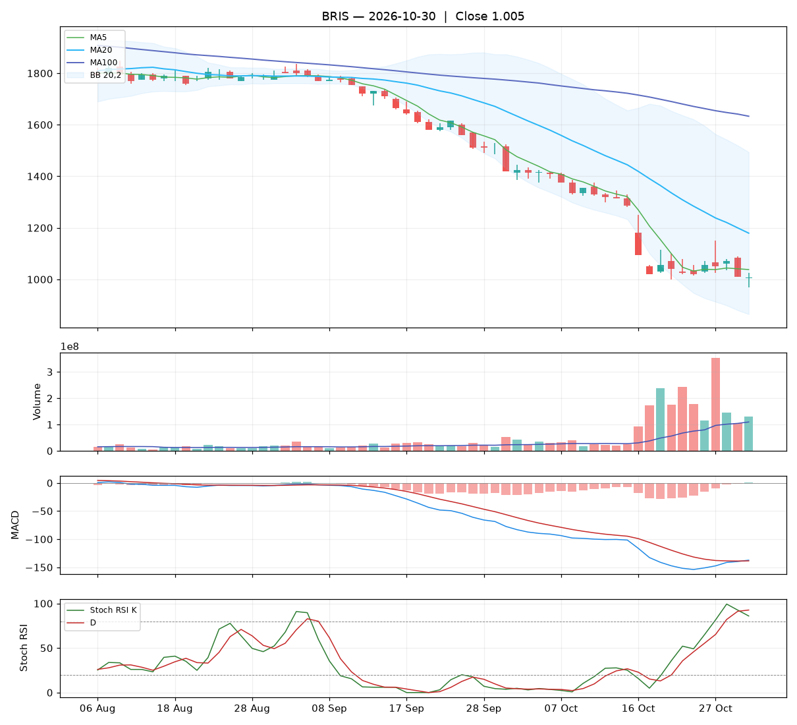

# Analisa harian BRIS — 2026-10-30

## Ringkasan

| Open | High | Low | Close | Perubahan | Volume |
|---|---|---|---|---|---|
| 1.005 | 1.025 | 970 | **1.005** | -5 (-0.50%) | 130.069.300 |

### 🔴 Keputusan teknikal: **HINDARI** — nilai total **3.7/10**

Mayoritas indikator searah turun. Bagi yang memegang, pertimbangkan batas rugi.

| Aspek | Nilai | |
|---|---|---|
| Tren | **0.0**/10 | `░░░░░░░░░░` |
| Volume | **3.3**/10 | `███░░░░░░░` |
| Stochastic | **2.8**/10 | `███░░░░░░░` |
| Momentum | **7.0**/10 | `███████░░░` |
| Candle | **7.0**/10 | `███████░░░` |

**Level harga (otomatis):**

- Support 20 hari: 970 · Resistance 20 hari: 1.425
- Batas rugi (stop loss): 955 (di bawah support atau −5%)
- Target 1: 1.179 · Target 2: 1.425
- Rasio untung : rugi ke target 1 = 3.47 : 1

## 1. Candlestick

Candle netral. Badan 0% dari rentang hari ini, sumbu atas 36%, sumbu bawah 64%.

- 🟢 **Dragonfly doji** — Badan sangat kecil dengan sumbu bawah panjang: penjual sempat menekan, tetapi pembeli mengembalikan harga.

## 2. Volume

- Volume hari ini 130.069.300 lembar, rata-rata 20 hari 109.798.510 (**1.18x** rata-rata).
- Volume normal.
- 5 hari terakhir: volume candle hijau 36%, candle merah 64%.

## 3. Stochastic & Stoch RSI

- Stochastic (14,3,3): %K 10.2, %D 12.2, zona **jenuh jual (oversold)**.
- Stoch RSI (14,14,3,3): K 86.0, D 92.6, zona **overbought**.
- Stoch RSI K memotong D ke bawah: momentum mulai melemah.

## 4. Tren (Moving Average)

Tren jangka pendek: **turun** (MA20 berubah -105 dalam 5 hari).
- Harga di bawah MA5 (1.038).
- Harga di bawah MA20 (1.179).
- Harga di bawah MA100 (1.633).

## 5. Bollinger Bands

- Bollinger (20,2): atas 1.494, tengah 1.179, bawah 865. Posisi harga 22% dari pita bawah ke atas, lebar pita 53.3%.

## 6. MACD & RSI

- MACD (12,26,9): garis -137.31, sinyal -138.55, histogram 1.24.
- MACD memotong garis sinyal ke atas (bullish cross).
- MACD masih di bawah nol: tren menengah masih lemah.
- RSI (14): 20.1 — oversold.

## 7. Support & Resistance

- Support 20 hari (low terendah): 970.
- Resistance 20 hari (high tertinggi): 1.425.
- Resistance terdekat lain: MA20 1.179, MA100 1.633.

## 8. Fundamental (laporan keuangan)

**Nilai fundamental: 9.7/10 — Kuat** (terpisah dari keputusan teknikal; dipakai untuk menilai kualitas perusahaan jangka panjang).

| PER | PBV | ROE | DER | Margin laba | Pendapatan YoY | Laba YoY | Kapitalisasi |
|---|---|---|---|---|---|---|---|
| 5.8 | 0.91 | 16.1% | 0.18x | 31.5% | 7.2% | 4.1% | 46.36 T |

Laporan laba rugi per kuartal (miliar Rp):

| Periode | Pendapatan | Laba bersih |
|---|---|---|
| 2026-06-30 | 6271.7 | 1955.6 |
| 2026-03-31 | 6670.9 | 2200.1 |
| 2025-12-31 | 6625.2 | 1998.6 |
| 2025-06-30 | 5849.1 | 1862.4 |
| 2025-03-31 | - | 1878.8 |

| Kondisi | Poin |
|---|---|
| PER 5.8x: murah | +1.00 |
| PBV 0.91x: di bawah nilai buku | +0.75 |
| ROE 16%: sangat efisien | +1.25 |
| DER 0.18x: utang rendah | +0.75 |
| Margin laba bersih 32%: sehat | +0.50 |
| Pendapatan tumbuh +7% YoY | +0.29 |
| Laba bersih tumbuh +4% YoY | +0.12 |

_Sumber: Yahoo Finance. Untuk keputusan penting, cocokkan dengan laporan resmi di idx.co.id._

## 9. Cara nilai teknikal dihitung

Setiap aspek mulai dari **5** (netral), lalu ditambah atau dikurangi poin di bawah ini, dan dibatasi 0–10. Nilai total = rata-rata berbobot.

**Tren: 0.0/10** (bobot 25%)

| Kondisi | Poin |
|---|---|
| Harga di bawah MA5 | -1.00 |
| Harga di bawah MA20 | -1.50 |
| Harga di bawah MA100 | -1.50 |
| MA20 menurun dalam 5 hari | -1.00 |

**Volume: 3.3/10** (bobot 20%)

| Kondisi | Poin |
|---|---|
| Harga turun dengan volume 1.18x rata-rata 20 hari | -1.18 |
| Volume hijau 5 hari 36% (akumulasi vs distribusi) | -0.55 |

**Stochastic: 2.8/10** (bobot 20%)

| Kondisi | Poin |
|---|---|
| Stochastic: K di bawah D | -0.75 |
| Stochastic oversold (10): peluang pantulan | +0.75 |
| Stoch RSI: K memotong D ke bawah | -1.50 |
| Stoch RSI overbought (86): rawan koreksi | -0.75 |

**Momentum: 7.0/10** (bobot 20%)

| Kondisi | Poin |
|---|---|
| MACD di atas garis sinyal | +1.50 |
| MACD di bawah nol | -1.00 |
| Histogram MACD membaik | +1.00 |
| RSI 20 oversold, peluang pantulan | +0.50 |

**Candle: 7.0/10** (bobot 15%)

| Kondisi | Poin |
|---|---|
| Badan candle netral 0% dari rentang | +0.00 |
| Pola Dragonfly doji | +2.00 |

_Laporan ini dibuat otomatis dari aturan teknikal sederhana. Bukan rekomendasi beli atau jual; selalu kombinasikan dengan analisa sendiri dan manajemen risiko._
