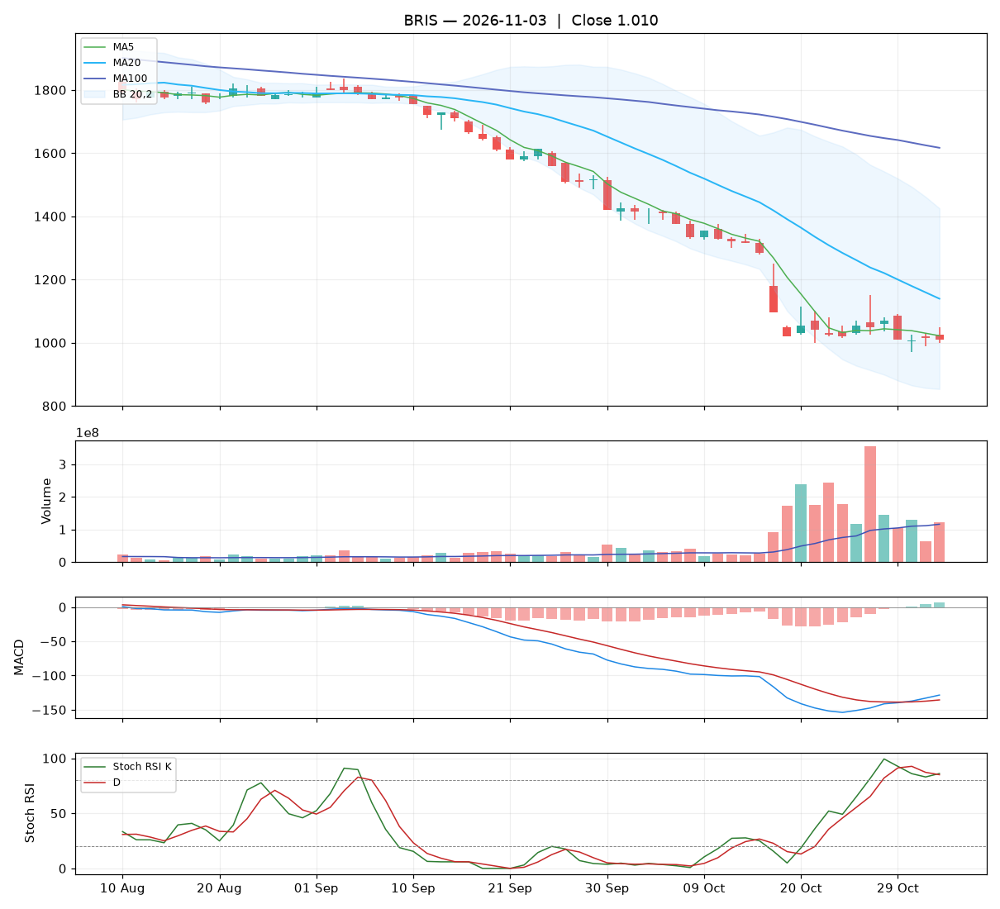

# Analisa harian BRIS — 2026-11-03

## Ringkasan

| Open | High | Low | Close | Perubahan | Volume |
|---|---|---|---|---|---|
| 1.025 | 1.050 | 1.000 | **1.010** | -5 (-0.49%) | 120.574.500 |

### ⚪ Keputusan teknikal: **TUNGGU** — nilai total **4.3/10**

Sinyal campur aduk. Belum ada alasan teknikal yang jelas untuk masuk.

| Aspek | Nilai | |
|---|---|---|
| Tren | **0.0**/10 | `░░░░░░░░░░` |
| Volume | **3.3**/10 | `███░░░░░░░` |
| Stochastic | **8.0**/10 | `████████░░` |
| Momentum | **7.0**/10 | `███████░░░` |
| Candle | **4.5**/10 | `█████░░░░░` |

**Level harga (otomatis):**

- Support 20 hari: 970 · Resistance 20 hari: 1.415
- Batas rugi (stop loss): 960 (di bawah support atau −5%)
- Target 1: 1.139 · Target 2: 1.415
- Rasio untung : rugi ke target 1 = 2.56 : 1

## 1. Candlestick

Candle merah (ditutup turun). Badan 30% dari rentang hari ini, sumbu atas 50%, sumbu bawah 20%.

- Tidak ada pola candle khusus yang terdeteksi.

## 2. Volume

- Volume hari ini 120.574.500 lembar, rata-rata 20 hari 115.795.310 (**1.04x** rata-rata).
- Volume normal.
- 5 hari terakhir: volume candle hijau 33%, candle merah 67%.

## 3. Stochastic & Stoch RSI

- Stochastic (14,3,3): %K 10.8, %D 9.7, zona **jenuh jual (oversold)**.
- %K memotong %D ke atas di area oversold: sinyal pantulan.
- Stoch RSI (14,14,3,3): K 86.1, D 85.0, zona **overbought**.
- Stoch RSI K memotong D ke atas: momentum mulai menguat.

## 4. Tren (Moving Average)

Tren jangka pendek: **turun** (MA20 berubah -99 dalam 5 hari).
- Harga di bawah MA5 (1.022).
- Harga di bawah MA20 (1.139).
- Harga di bawah MA100 (1.617).

## 5. Bollinger Bands

- Bollinger (20,2): atas 1.425, tengah 1.139, bawah 853. Posisi harga 27% dari pita bawah ke atas, lebar pita 50.2%.

## 6. MACD & RSI

- MACD (12,26,9): garis -128.57, sinyal -135.67, histogram 7.10.
- Histogram membaik dibanding kemarin: tekanan turun berkurang / tekanan naik bertambah.
- MACD masih di bawah nol: tren menengah masih lemah.
- RSI (14): 21.8 — oversold.

## 7. Support & Resistance

- Support 20 hari (low terendah): 970.
- Resistance 20 hari (high tertinggi): 1.415.
- Resistance terdekat lain: MA20 1.139, MA100 1.617.

## 8. Fundamental (laporan keuangan)

**Nilai fundamental: 9.7/10 — Kuat** (terpisah dari keputusan teknikal; dipakai untuk menilai kualitas perusahaan jangka panjang).

| PER | PBV | ROE | DER | Margin laba | Pendapatan YoY | Laba YoY | Kapitalisasi |
|---|---|---|---|---|---|---|---|
| 5.8 | 0.91 | 16.1% | 0.18x | 31.5% | 7.2% | 4.1% | 46.59 T |

Laporan laba rugi per kuartal (miliar Rp):

| Periode | Pendapatan | Laba bersih |
|---|---|---|
| 2026-06-30 | 6271.7 | 1955.6 |
| 2026-03-31 | 6670.9 | 2200.1 |
| 2025-12-31 | 6625.2 | 1998.6 |
| 2025-06-30 | 5849.1 | 1862.4 |
| 2025-03-31 | - | 1878.8 |

| Kondisi | Poin |
|---|---|
| PER 5.8x: murah | +1.00 |
| PBV 0.91x: di bawah nilai buku | +0.75 |
| ROE 16%: sangat efisien | +1.25 |
| DER 0.18x: utang rendah | +0.75 |
| Margin laba bersih 32%: sehat | +0.50 |
| Pendapatan tumbuh +7% YoY | +0.29 |
| Laba bersih tumbuh +4% YoY | +0.12 |

_Sumber: Yahoo Finance. Untuk keputusan penting, cocokkan dengan laporan resmi di idx.co.id._

## 9. Cara nilai teknikal dihitung

Setiap aspek mulai dari **5** (netral), lalu ditambah atau dikurangi poin di bawah ini, dan dibatasi 0–10. Nilai total = rata-rata berbobot.

**Tren: 0.0/10** (bobot 25%)

| Kondisi | Poin |
|---|---|
| Harga di bawah MA5 | -1.00 |
| Harga di bawah MA20 | -1.50 |
| Harga di bawah MA100 | -1.50 |
| MA20 menurun dalam 5 hari | -1.00 |

**Volume: 3.3/10** (bobot 20%)

| Kondisi | Poin |
|---|---|
| Harga turun dengan volume 1.04x rata-rata 20 hari | -1.04 |
| Volume hijau 5 hari 33% (akumulasi vs distribusi) | -0.67 |

**Stochastic: 8.0/10** (bobot 20%)

| Kondisi | Poin |
|---|---|
| Stochastic: K memotong D ke atas | +1.50 |
| Stochastic oversold (11): peluang pantulan | +0.75 |
| Stoch RSI: K memotong D ke atas | +1.50 |
| Stoch RSI overbought (86): rawan koreksi | -0.75 |

**Momentum: 7.0/10** (bobot 20%)

| Kondisi | Poin |
|---|---|
| MACD di atas garis sinyal | +1.50 |
| MACD di bawah nol | -1.00 |
| Histogram MACD membaik | +1.00 |
| RSI 22 oversold, peluang pantulan | +0.50 |

**Candle: 4.5/10** (bobot 15%)

| Kondisi | Poin |
|---|---|
| Badan candle merah 30% dari rentang | -0.45 |

_Laporan ini dibuat otomatis dari aturan teknikal sederhana. Bukan rekomendasi beli atau jual; selalu kombinasikan dengan analisa sendiri dan manajemen risiko._
