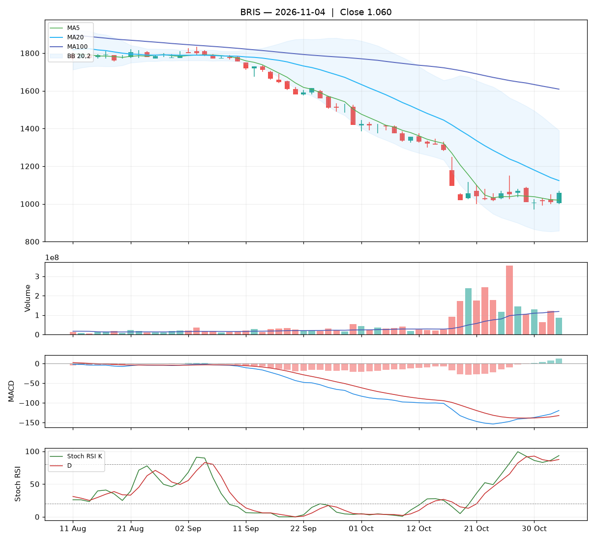

# Analisa harian BRIS — 2026-11-04

## Ringkasan

| Open | High | Low | Close | Perubahan | Volume |
|---|---|---|---|---|---|
| 1.005 | 1.070 | 1.000 | **1.060** | +50 (+4.95%) | 85.090.900 |

### ⚪ Keputusan teknikal: **TUNGGU** — nilai total **5.2/10**

Sinyal campur aduk. Belum ada alasan teknikal yang jelas untuk masuk.

| Aspek | Nilai | |
|---|---|---|
| Tren | **2.0**/10 | `██░░░░░░░░` |
| Volume | **4.6**/10 | `█████░░░░░` |
| Stochastic | **6.5**/10 | `██████░░░░` |
| Momentum | **6.0**/10 | `██████░░░░` |
| Candle | **8.2**/10 | `████████░░` |

**Level harga (otomatis):**

- Support 20 hari: 970 · Resistance 20 hari: 1.385
- Batas rugi (stop loss): 970 (di bawah support atau −5%)
- Target 1: 1.124 · Target 2: 1.385
- Rasio untung : rugi ke target 1 = 0.71 : 1 (kurang menarik, idealnya ≥ 1,5)

## 1. Candlestick

Candle hijau (ditutup naik). Badan 79% dari rentang hari ini, sumbu atas 14%, sumbu bawah 7%.

- 🟢 **Bullish engulfing** — Badan hijau menelan badan merah sebelumnya: pembeli mengambil alih.

## 2. Volume

- Volume hari ini 85.090.900 lembar, rata-rata 20 hari 118.382.660 (**0.72x** rata-rata).
- Volume normal.
- 5 hari terakhir: volume candle hijau 23%, candle merah 77%.

## 3. Stochastic & Stoch RSI

- Stochastic (14,3,3): %K 18.4, %D 12.4, zona **jenuh jual (oversold)**.
- Stoch RSI (14,14,3,3): K 93.4, D 87.5, zona **overbought**.
- K di atas D: momentum masih naik.

## 4. Tren (Moving Average)

Tren jangka pendek: **turun** (MA20 berubah -97 dalam 5 hari).
- Harga di atas MA5 (1.020).
- Harga di bawah MA20 (1.124).
- Harga di bawah MA100 (1.609).

## 5. Bollinger Bands

- Bollinger (20,2): atas 1.390, tengah 1.124, bawah 857. Posisi harga 38% dari pita bawah ke atas, lebar pita 47.4%.

## 6. MACD & RSI

- MACD (12,26,9): garis -119.61, sinyal -132.46, histogram 12.84.
- Histogram membaik dibanding kemarin: tekanan turun berkurang / tekanan naik bertambah.
- MACD masih di bawah nol: tren menengah masih lemah.
- RSI (14): 31.7.

## 7. Support & Resistance

- Support 20 hari (low terendah): 970.
- Resistance 20 hari (high tertinggi): 1.385.
- Resistance terdekat lain: MA20 1.124, MA100 1.609.

## 8. Fundamental (laporan keuangan)

**Nilai fundamental: 9.7/10 — Kuat** (terpisah dari keputusan teknikal; dipakai untuk menilai kualitas perusahaan jangka panjang).

| PER | PBV | ROE | DER | Margin laba | Pendapatan YoY | Laba YoY | Kapitalisasi |
|---|---|---|---|---|---|---|---|
| 6.2 | 0.96 | 16.1% | 0.18x | 31.5% | 7.2% | 4.1% | 48.90 T |

Laporan laba rugi per kuartal (miliar Rp):

| Periode | Pendapatan | Laba bersih |
|---|---|---|
| 2026-06-30 | 6271.7 | 1955.6 |
| 2026-03-31 | 6670.9 | 2200.1 |
| 2025-12-31 | 6625.2 | 1998.6 |
| 2025-06-30 | 5849.1 | 1862.4 |
| 2025-03-31 | - | 1878.8 |

| Kondisi | Poin |
|---|---|
| PER 6.2x: murah | +1.00 |
| PBV 0.96x: di bawah nilai buku | +0.75 |
| ROE 16%: sangat efisien | +1.25 |
| DER 0.18x: utang rendah | +0.75 |
| Margin laba bersih 32%: sehat | +0.50 |
| Pendapatan tumbuh +7% YoY | +0.29 |
| Laba bersih tumbuh +4% YoY | +0.12 |

_Sumber: Yahoo Finance. Untuk keputusan penting, cocokkan dengan laporan resmi di idx.co.id._

## 9. Cara nilai teknikal dihitung

Setiap aspek mulai dari **5** (netral), lalu ditambah atau dikurangi poin di bawah ini, dan dibatasi 0–10. Nilai total = rata-rata berbobot.

**Tren: 2.0/10** (bobot 25%)

| Kondisi | Poin |
|---|---|
| Harga di atas MA5 | +1.00 |
| Harga di bawah MA20 | -1.50 |
| Harga di bawah MA100 | -1.50 |
| MA20 menurun dalam 5 hari | -1.00 |

**Volume: 4.6/10** (bobot 20%)

| Kondisi | Poin |
|---|---|
| Harga naik dengan volume 0.72x rata-rata 20 hari | +0.72 |
| Volume hijau 5 hari 23% (akumulasi vs distribusi) | -1.09 |

**Stochastic: 6.5/10** (bobot 20%)

| Kondisi | Poin |
|---|---|
| Stochastic: K di atas D | +0.75 |
| Stochastic oversold (18): peluang pantulan | +0.75 |
| Stoch RSI: K di atas D | +0.75 |
| Stoch RSI overbought (93): rawan koreksi | -0.75 |

**Momentum: 6.0/10** (bobot 20%)

| Kondisi | Poin |
|---|---|
| MACD di atas garis sinyal | +1.50 |
| MACD di bawah nol | -1.00 |
| Histogram MACD membaik | +1.00 |
| RSI 32 di zona lemah (30–50) | -0.50 |

**Candle: 8.2/10** (bobot 15%)

| Kondisi | Poin |
|---|---|
| Badan candle hijau 79% dari rentang | +1.18 |
| Pola Bullish engulfing | +2.00 |

_Laporan ini dibuat otomatis dari aturan teknikal sederhana. Bukan rekomendasi beli atau jual; selalu kombinasikan dengan analisa sendiri dan manajemen risiko._
