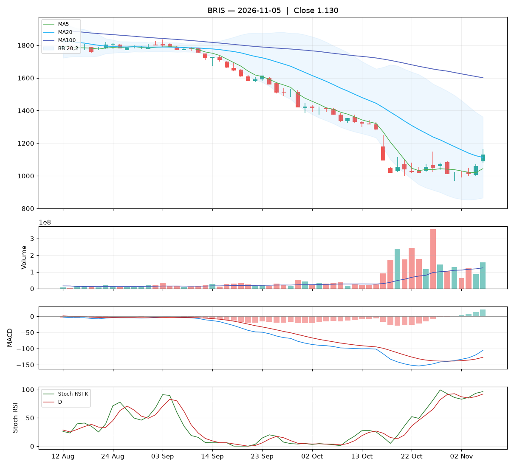

# Analisa harian BRIS — 2026-11-05

## Ringkasan

| Open | High | Low | Close | Perubahan | Volume |
|---|---|---|---|---|---|
| 1.090 | 1.165 | 1.080 | **1.130** | +70 (+6.60%) | 157.640.300 |

### 🟡 Keputusan teknikal: **PANTAU** — nilai total **5.8/10**

Cukup positif, tetapi belum kuat. Tunggu konfirmasi candle/volume berikutnya.

| Aspek | Nilai | |
|---|---|---|
| Tren | **5.0**/10 | `█████░░░░░` |
| Volume | **6.5**/10 | `███████░░░` |
| Stochastic | **5.8**/10 | `██████░░░░` |
| Momentum | **6.0**/10 | `██████░░░░` |
| Candle | **5.7**/10 | `██████░░░░` |

**Level harga (otomatis):**

- Support 20 hari: 970 · Resistance 20 hari: 1.375
- Batas rugi (stop loss): 970 (di bawah support atau −5%)
- Target 1: 1.375 · Target 2: 1.361
- Rasio untung : rugi ke target 1 = 1.53 : 1

## 1. Candlestick

Candle hijau (ditutup naik). Badan 47% dari rentang hari ini, sumbu atas 41%, sumbu bawah 12%.

- Tidak ada pola candle khusus yang terdeteksi.

## 2. Volume

- Volume hari ini 157.640.300 lembar, rata-rata 20 hari 124.232.150 (**1.27x** rata-rata).
- Volume normal.
- 5 hari terakhir: volume candle hijau 57%, candle merah 43%.

## 3. Stochastic & Stoch RSI

- Stochastic (14,3,3): %K 41.8, %D 23.7, zona **tengah**.
- Stoch RSI (14,14,3,3): K 96.4, D 92.0, zona **overbought**.
- K di atas D: momentum masih naik.

## 4. Tren (Moving Average)

Tren jangka pendek: **sideways / belum jelas** (MA20 berubah -86 dalam 5 hari).
- Harga di atas MA5 (1.044).
- Harga di atas MA20 (1.113).
- Harga di bawah MA100 (1.601).

## 5. Bollinger Bands

- Bollinger (20,2): atas 1.361, tengah 1.113, bawah 865. Posisi harga 53% dari pita bawah ke atas, lebar pita 44.6%.

## 6. MACD & RSI

- MACD (12,26,9): garis -105.65, sinyal -127.10, histogram 21.45.
- Histogram membaik dibanding kemarin: tekanan turun berkurang / tekanan naik bertambah.
- MACD masih di bawah nol: tren menengah masih lemah.
- RSI (14): 42.7.

## 7. Support & Resistance

- Support 20 hari (low terendah): 970.
- Resistance 20 hari (high tertinggi): 1.375.
- Resistance terdekat lain: MA20 1.113, MA100 1.601.

## 8. Fundamental (laporan keuangan)

**Nilai fundamental: 8.9/10 — Kuat** (terpisah dari keputusan teknikal; dipakai untuk menilai kualitas perusahaan jangka panjang).

| PER | PBV | ROE | DER | Margin laba | Pendapatan YoY | Laba YoY | Kapitalisasi |
|---|---|---|---|---|---|---|---|
| 6.5 | 1.02 | 16.1% | 0.18x | 31.5% | 7.2% | 4.1% | 52.13 T |

Laporan laba rugi per kuartal (miliar Rp):

| Periode | Pendapatan | Laba bersih |
|---|---|---|
| 2026-06-30 | 6271.7 | 1955.6 |
| 2026-03-31 | 6670.9 | 2200.1 |
| 2025-12-31 | 6625.2 | 1998.6 |
| 2025-06-30 | 5849.1 | 1862.4 |
| 2025-03-31 | - | 1878.8 |

| Kondisi | Poin |
|---|---|
| PER 6.5x: murah | +1.00 |
| ROE 16%: sangat efisien | +1.25 |
| DER 0.18x: utang rendah | +0.75 |
| Margin laba bersih 32%: sehat | +0.50 |
| Pendapatan tumbuh +7% YoY | +0.29 |
| Laba bersih tumbuh +4% YoY | +0.12 |

_Sumber: Yahoo Finance. Untuk keputusan penting, cocokkan dengan laporan resmi di idx.co.id._

## 9. Cara nilai teknikal dihitung

Setiap aspek mulai dari **5** (netral), lalu ditambah atau dikurangi poin di bawah ini, dan dibatasi 0–10. Nilai total = rata-rata berbobot.

**Tren: 5.0/10** (bobot 25%)

| Kondisi | Poin |
|---|---|
| Harga di atas MA5 | +1.00 |
| Harga di atas MA20 | +1.50 |
| Harga di bawah MA100 | -1.50 |
| MA20 menurun dalam 5 hari | -1.00 |

**Volume: 6.5/10** (bobot 20%)

| Kondisi | Poin |
|---|---|
| Harga naik dengan volume 1.27x rata-rata 20 hari | +1.27 |
| Volume hijau 5 hari 57% (akumulasi vs distribusi) | +0.27 |

**Stochastic: 5.8/10** (bobot 20%)

| Kondisi | Poin |
|---|---|
| Stochastic: K di atas D | +0.75 |
| Stoch RSI: K di atas D | +0.75 |
| Stoch RSI overbought (96): rawan koreksi | -0.75 |

**Momentum: 6.0/10** (bobot 20%)

| Kondisi | Poin |
|---|---|
| MACD di atas garis sinyal | +1.50 |
| MACD di bawah nol | -1.00 |
| Histogram MACD membaik | +1.00 |
| RSI 43 di zona lemah (30–50) | -0.50 |

**Candle: 5.7/10** (bobot 15%)

| Kondisi | Poin |
|---|---|
| Badan candle hijau 47% dari rentang | +0.71 |

_Laporan ini dibuat otomatis dari aturan teknikal sederhana. Bukan rekomendasi beli atau jual; selalu kombinasikan dengan analisa sendiri dan manajemen risiko._
