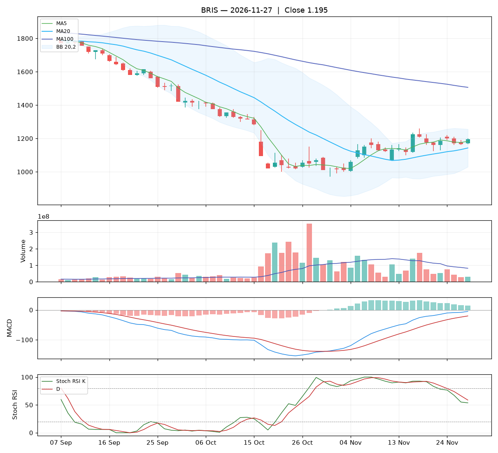

# Analisa harian BRIS — 2026-11-27

## Ringkasan

| Open | High | Low | Close | Perubahan | Volume |
|---|---|---|---|---|---|
| 1.170 | 1.200 | 1.165 | **1.195** | +30 (+2.58%) | 29.279.200 |

### 🟡 Keputusan teknikal: **PANTAU** — nilai total **5.7/10**

Cukup positif, tetapi belum kuat. Tunggu konfirmasi candle/volume berikutnya.

| Aspek | Nilai | |
|---|---|---|
| Tren | **7.0**/10 | `███████░░░` |
| Volume | **4.8**/10 | `█████░░░░░` |
| Stochastic | **3.5**/10 | `████░░░░░░` |
| Momentum | **5.5**/10 | `██████░░░░` |
| Candle | **8.1**/10 | `████████░░` |

**Level harga (otomatis):**

- Support 20 hari: 990 · Resistance 20 hari: 1.260
- Batas rugi (stop loss): 990 (di bawah support atau −5%)
- Target 1: 1.260 · Target 2: 1.256
- Rasio untung : rugi ke target 1 = 0.32 : 1 (kurang menarik, idealnya ≥ 1,5)

## 1. Candlestick

Candle hijau (ditutup naik). Badan 71% dari rentang hari ini, sumbu atas 14%, sumbu bawah 14%.

- 🟢 **Morning star** — Merah besar, lalu candle kecil, lalu hijau kuat: pola pembalikan naik.

## 2. Volume

- Volume hari ini 29.279.200 lembar, rata-rata 20 hari 81.754.105 (**0.36x** rata-rata).
- Volume sepi: pergerakan hari ini kurang meyakinkan.
- 5 hari terakhir: volume candle hijau 36%, candle merah 64%.

## 3. Stochastic & Stoch RSI

- Stochastic (14,3,3): %K 56.1, %D 59.1, zona **tengah**.
- Stoch RSI (14,14,3,3): K 53.7, D 58.7, zona **tengah**.
- K di bawah D: momentum masih turun.

## 4. Tren (Moving Average)

Tren jangka pendek: **naik** (MA20 berubah 36 dalam 5 hari).
- Harga di atas MA5 (1.183).
- Harga di atas MA20 (1.143).
- Harga di bawah MA100 (1.506).

## 5. Bollinger Bands

- Bollinger (20,2): atas 1.256, tengah 1.143, bawah 1.030. Posisi harga 73% dari pita bawah ke atas, lebar pita 19.8%.

## 6. MACD & RSI

- MACD (12,26,9): garis -5.03, sinyal -20.12, histogram 15.08.
- Histogram memburuk dibanding kemarin.
- MACD masih di bawah nol: tren menengah masih lemah.
- RSI (14): 52.7.

## 7. Support & Resistance

- Support 20 hari (low terendah): 990.
- Resistance 20 hari (high tertinggi): 1.260.
- Resistance terdekat lain: MA20 1.143, MA100 1.506.

## 8. Fundamental (laporan keuangan)

**Nilai fundamental: 8.9/10 — Kuat** (terpisah dari keputusan teknikal; dipakai untuk menilai kualitas perusahaan jangka panjang).

| PER | PBV | ROE | DER | Margin laba | Pendapatan YoY | Laba YoY | Kapitalisasi |
|---|---|---|---|---|---|---|---|
| 6.8 | 1.06 | 15.8% | 0.18x | 31.3% | 7.2% | 4.1% | 55.12 T |

Laporan laba rugi per kuartal (miliar Rp):

| Periode | Pendapatan | Laba bersih |
|---|---|---|
| 2026-06-30 | 6271.7 | 1955.6 |
| 2026-03-31 | 6670.9 | 2200.1 |
| 2025-12-31 | 6625.2 | 1998.6 |
| 2025-06-30 | 5849.1 | 1862.4 |
| 2025-03-31 | - | 1878.8 |

| Kondisi | Poin |
|---|---|
| PER 6.8x: murah | +1.00 |
| ROE 16%: sangat efisien | +1.25 |
| DER 0.18x: utang rendah | +0.75 |
| Margin laba bersih 31%: sehat | +0.50 |
| Pendapatan tumbuh +7% YoY | +0.29 |
| Laba bersih tumbuh +4% YoY | +0.12 |

_Sumber: Yahoo Finance. Untuk keputusan penting, cocokkan dengan laporan resmi di idx.co.id._

## 9. Cara nilai teknikal dihitung

Setiap aspek mulai dari **5** (netral), lalu ditambah atau dikurangi poin di bawah ini, dan dibatasi 0–10. Nilai total = rata-rata berbobot.

**Tren: 7.0/10** (bobot 25%)

| Kondisi | Poin |
|---|---|
| Harga di atas MA5 | +1.00 |
| Harga di atas MA20 | +1.50 |
| Harga di bawah MA100 | -1.50 |
| MA20 menanjak dalam 5 hari | +1.00 |

**Volume: 4.8/10** (bobot 20%)

| Kondisi | Poin |
|---|---|
| Harga naik dengan volume 0.36x rata-rata 20 hari | +0.36 |
| Volume hijau 5 hari 36% (akumulasi vs distribusi) | -0.54 |

**Stochastic: 3.5/10** (bobot 20%)

| Kondisi | Poin |
|---|---|
| Stochastic: K di bawah D | -0.75 |
| Stoch RSI: K di bawah D | -0.75 |

**Momentum: 5.5/10** (bobot 20%)

| Kondisi | Poin |
|---|---|
| MACD di atas garis sinyal | +1.50 |
| MACD di bawah nol | -1.00 |
| Histogram MACD memburuk | -1.00 |
| RSI 53 di zona kuat (50–70) | +1.00 |

**Candle: 8.1/10** (bobot 15%)

| Kondisi | Poin |
|---|---|
| Badan candle hijau 71% dari rentang | +1.07 |
| Pola Morning star | +2.00 |

_Laporan ini dibuat otomatis dari aturan teknikal sederhana. Bukan rekomendasi beli atau jual; selalu kombinasikan dengan analisa sendiri dan manajemen risiko._
