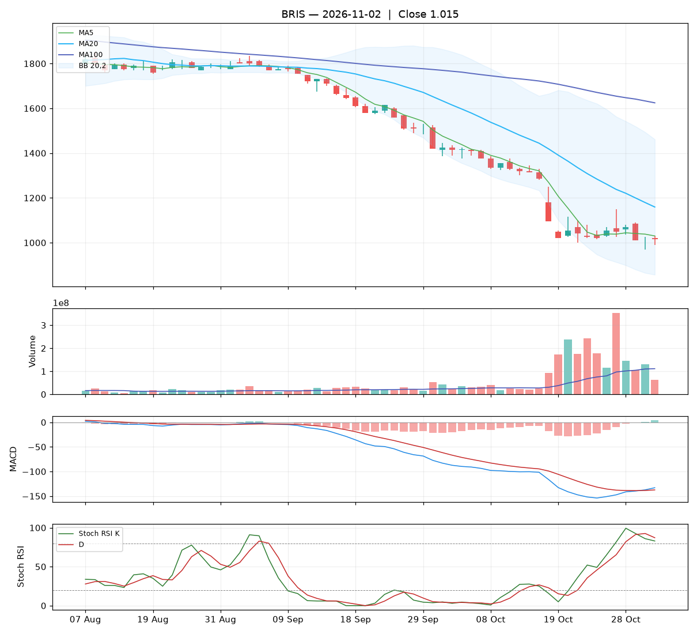

# Analisa harian BRIS — 2026-11-02

## Ringkasan

| Open | High | Low | Close | Perubahan | Volume |
|---|---|---|---|---|---|
| 1.020 | 1.030 | 990 | **1.015** | +10 (+1.00%) | 63.929.800 |

### 🔴 Keputusan teknikal: **HINDARI** — nilai total **3.8/10**

Mayoritas indikator searah turun. Bagi yang memegang, pertimbangkan batas rugi.

| Aspek | Nilai | |
|---|---|---|
| Tren | **0.0**/10 | `░░░░░░░░░░` |
| Volume | **4.4**/10 | `████░░░░░░` |
| Stochastic | **3.5**/10 | `████░░░░░░` |
| Momentum | **7.0**/10 | `███████░░░` |
| Candle | **5.3**/10 | `█████░░░░░` |

**Level harga (otomatis):**

- Support 20 hari: 970 · Resistance 20 hari: 1.420
- Batas rugi (stop loss): 964 (di bawah support atau −5%)
- Target 1: 1.159 · Target 2: 1.420
- Rasio untung : rugi ke target 1 = 2.84 : 1

## 1. Candlestick

Candle merah (ditutup turun). Badan 12% dari rentang hari ini, sumbu atas 25%, sumbu bawah 62%.

- Tidak ada pola candle khusus yang terdeteksi.

## 2. Volume

- Volume hari ini 63.929.800 lembar, rata-rata 20 hari 111.255.630 (**0.57x** rata-rata).
- Volume sepi: pergerakan hari ini kurang meyakinkan.
- 5 hari terakhir: volume candle hijau 22%, candle merah 78%.

## 3. Stochastic & Stoch RSI

- Stochastic (14,3,3): %K 8.0, %D 9.9, zona **jenuh jual (oversold)**.
- Stoch RSI (14,14,3,3): K 83.0, D 87.2, zona **overbought**.
- K di bawah D: momentum masih turun.

## 4. Tren (Moving Average)

Tren jangka pendek: **turun** (MA20 berubah -102 dalam 5 hari).
- Harga di bawah MA5 (1.030).
- Harga di bawah MA20 (1.159).
- Harga di bawah MA100 (1.625).

## 5. Bollinger Bands

- Bollinger (20,2): atas 1.462, tengah 1.159, bawah 857. Posisi harga 26% dari pita bawah ke atas, lebar pita 52.2%.

## 6. MACD & RSI

- MACD (12,26,9): garis -133.03, sinyal -137.44, histogram 4.41.
- Histogram membaik dibanding kemarin: tekanan turun berkurang / tekanan naik bertambah.
- MACD masih di bawah nol: tren menengah masih lemah.
- RSI (14): 22.1 — oversold.

## 7. Support & Resistance

- Support 20 hari (low terendah): 970.
- Resistance 20 hari (high tertinggi): 1.420.
- Resistance terdekat lain: MA20 1.159, MA100 1.625.

## 8. Fundamental (laporan keuangan)

**Nilai fundamental: 9.7/10 — Kuat** (terpisah dari keputusan teknikal; dipakai untuk menilai kualitas perusahaan jangka panjang).

| PER | PBV | ROE | DER | Margin laba | Pendapatan YoY | Laba YoY | Kapitalisasi |
|---|---|---|---|---|---|---|---|
| 5.9 | 0.92 | 16.1% | 0.18x | 31.5% | 7.2% | 4.1% | 46.82 T |

Laporan laba rugi per kuartal (miliar Rp):

| Periode | Pendapatan | Laba bersih |
|---|---|---|
| 2026-06-30 | 6271.7 | 1955.6 |
| 2026-03-31 | 6670.9 | 2200.1 |
| 2025-12-31 | 6625.2 | 1998.6 |
| 2025-06-30 | 5849.1 | 1862.4 |
| 2025-03-31 | - | 1878.8 |

| Kondisi | Poin |
|---|---|
| PER 5.9x: murah | +1.00 |
| PBV 0.92x: di bawah nilai buku | +0.75 |
| ROE 16%: sangat efisien | +1.25 |
| DER 0.18x: utang rendah | +0.75 |
| Margin laba bersih 32%: sehat | +0.50 |
| Pendapatan tumbuh +7% YoY | +0.29 |
| Laba bersih tumbuh +4% YoY | +0.12 |

_Sumber: Yahoo Finance. Untuk keputusan penting, cocokkan dengan laporan resmi di idx.co.id._

## 9. Cara nilai teknikal dihitung

Setiap aspek mulai dari **5** (netral), lalu ditambah atau dikurangi poin di bawah ini, dan dibatasi 0–10. Nilai total = rata-rata berbobot.

**Tren: 0.0/10** (bobot 25%)

| Kondisi | Poin |
|---|---|
| Harga di bawah MA5 | -1.00 |
| Harga di bawah MA20 | -1.50 |
| Harga di bawah MA100 | -1.50 |
| MA20 menurun dalam 5 hari | -1.00 |

**Volume: 4.4/10** (bobot 20%)

| Kondisi | Poin |
|---|---|
| Harga naik dengan volume 0.57x rata-rata 20 hari | +0.57 |
| Volume hijau 5 hari 22% (akumulasi vs distribusi) | -1.13 |

**Stochastic: 3.5/10** (bobot 20%)

| Kondisi | Poin |
|---|---|
| Stochastic: K di bawah D | -0.75 |
| Stochastic oversold (8): peluang pantulan | +0.75 |
| Stoch RSI: K di bawah D | -0.75 |
| Stoch RSI overbought (83): rawan koreksi | -0.75 |

**Momentum: 7.0/10** (bobot 20%)

| Kondisi | Poin |
|---|---|
| MACD di atas garis sinyal | +1.50 |
| MACD di bawah nol | -1.00 |
| Histogram MACD membaik | +1.00 |
| RSI 22 oversold, peluang pantulan | +0.50 |

**Candle: 5.3/10** (bobot 15%)

| Kondisi | Poin |
|---|---|
| Badan candle merah 12% dari rentang | -0.19 |
| Sumbu bawah lebih panjang: ada penolakan harga rendah | +0.50 |

_Laporan ini dibuat otomatis dari aturan teknikal sederhana. Bukan rekomendasi beli atau jual; selalu kombinasikan dengan analisa sendiri dan manajemen risiko._
