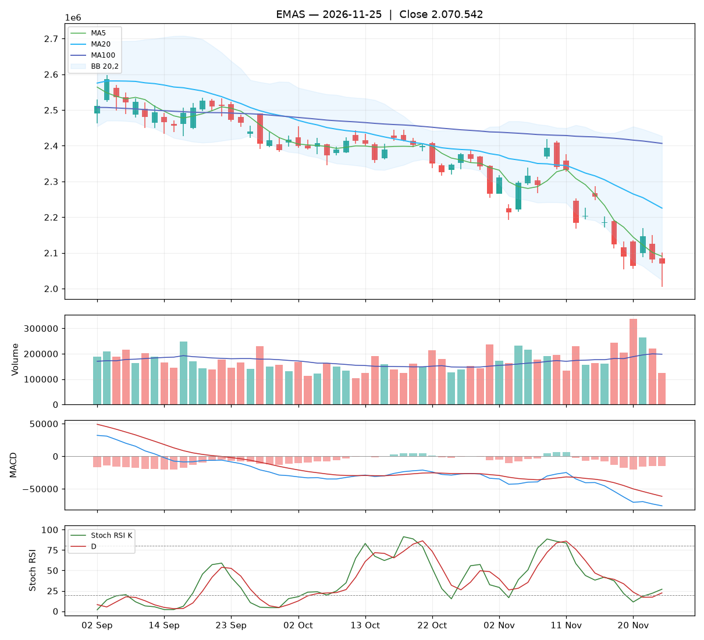

# Analisa harian EMAS — 2026-11-25

## Ringkasan

Harga emas dunia **USD 3,535.80/oz** × kurs **Rp 18.214** ÷ 31.10 gram = **Rp 2.070.542/gram** (spot, belum termasuk premi Antam/toko emas).

| Open | High | Low | Close | Perubahan | Volume |
|---|---|---|---|---|---|
| 2.084.304 | 2.101.637 | 2.005.776 | **2.070.542** | -11619 (-0.56%) | 124.601 |

### 🔴 Keputusan teknikal: **HINDARI** — nilai total **3.5/10**

Mayoritas indikator searah turun. Bagi yang memegang, pertimbangkan batas rugi.

| Aspek | Nilai | |
|---|---|---|
| Tren | **0.0**/10 | `░░░░░░░░░░` |
| Volume | **3.3**/10 | `███░░░░░░░` |
| Stochastic | **7.2**/10 | `███████░░░` |
| Momentum | **3.0**/10 | `███░░░░░░░` |
| Candle | **5.3**/10 | `█████░░░░░` |

**Level harga (otomatis):**

- Support 20 hari: 2.005.776 · Resistance 20 hari: 2.418.869
- Batas rugi (stop loss): 1.967.015 (di bawah support atau −5%)
- Target 1: 2.225.444 · Target 2: 2.418.869
- Rasio untung : rugi ke target 1 = 1.50 : 1 (kurang menarik, idealnya ≥ 1,5)

## 1. Candlestick

Candle merah (ditutup turun). Badan 14% dari rentang hari ini, sumbu atas 18%, sumbu bawah 68%.

- Tidak ada pola candle khusus yang terdeteksi.

## 2. Volume

- Volume hari ini 124.601 lembar, rata-rata 20 hari 198.204 (**0.63x** rata-rata).
- Volume sepi: pergerakan hari ini kurang meyakinkan.
- 5 hari terakhir: volume candle hijau 23%, candle merah 77%.

## 3. Stochastic & Stoch RSI

- Stochastic (14,3,3): %K 16.4, %D 13.8, zona **jenuh jual (oversold)**.
- Stoch RSI (14,14,3,3): K 27.0, D 22.5, zona **tengah**.
- K di atas D: momentum masih naik.

## 4. Tren (Moving Average)

Tren jangka pendek: **turun** (MA20 berubah -65.605 dalam 5 hari).
- Harga di bawah MA5 (2.090.474).
- Harga di bawah MA20 (2.225.444).
- Harga di bawah MA100 (2.406.547).

## 5. Bollinger Bands

- Bollinger (20,2): atas 2.427.113, tengah 2.225.444, bawah 2.023.776. Posisi harga 12% dari pita bawah ke atas, lebar pita 18.1%.

## 6. MACD & RSI

- MACD (12,26,9): garis -76096.32, sinyal -61506.29, histogram -14590.03.
- Histogram membaik dibanding kemarin: tekanan turun berkurang / tekanan naik bertambah.
- MACD masih di bawah nol: tren menengah masih lemah.
- RSI (14): 36.1.

## 7. Support & Resistance

- Support 20 hari (low terendah): 2.005.776.
- Resistance 20 hari (high tertinggi): 2.418.869.
- Resistance terdekat lain: MA20 2.225.444, MA100 2.406.547.

## 9. Cara nilai teknikal dihitung

Setiap aspek mulai dari **5** (netral), lalu ditambah atau dikurangi poin di bawah ini, dan dibatasi 0–10. Nilai total = rata-rata berbobot.

**Tren: 0.0/10** (bobot 25%)

| Kondisi | Poin |
|---|---|
| Harga di bawah MA5 | -1.00 |
| Harga di bawah MA20 | -1.50 |
| Harga di bawah MA100 | -1.50 |
| MA20 menurun dalam 5 hari | -1.00 |

**Volume: 3.3/10** (bobot 20%)

| Kondisi | Poin |
|---|---|
| Harga turun dengan volume 0.63x rata-rata 20 hari | -0.63 |
| Volume hijau 5 hari 23% (akumulasi vs distribusi) | -1.08 |

**Stochastic: 7.2/10** (bobot 20%)

| Kondisi | Poin |
|---|---|
| Stochastic: K di atas D | +0.75 |
| Stochastic oversold (16): peluang pantulan | +0.75 |
| Stoch RSI: K di atas D | +0.75 |

**Momentum: 3.0/10** (bobot 20%)

| Kondisi | Poin |
|---|---|
| MACD di bawah garis sinyal | -1.50 |
| MACD di bawah nol | -1.00 |
| Histogram MACD membaik | +1.00 |
| RSI 36 di zona lemah (30–50) | -0.50 |

**Candle: 5.3/10** (bobot 15%)

| Kondisi | Poin |
|---|---|
| Badan candle merah 14% dari rentang | -0.22 |
| Sumbu bawah lebih panjang: ada penolakan harga rendah | +0.50 |

_Laporan ini dibuat otomatis dari aturan teknikal sederhana. Bukan rekomendasi beli atau jual; selalu kombinasikan dengan analisa sendiri dan manajemen risiko._
