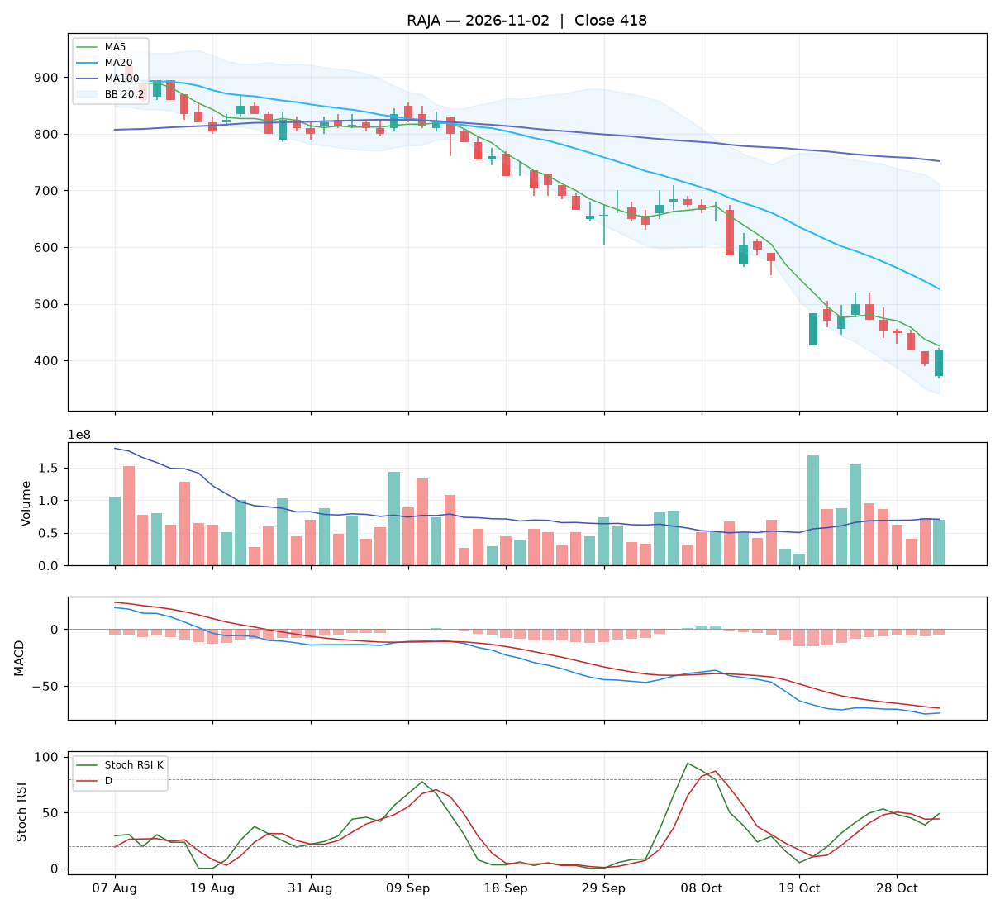

# Analisa harian RAJA — 2026-11-02

## Ringkasan

| Open | High | Low | Close | Perubahan | Volume |
|---|---|---|---|---|---|
| 372 | 422 | 368 | **418** | +24 (+6.09%) | 69.214.400 |

### ⚪ Keputusan teknikal: **TUNGGU** — nilai total **4.8/10**

Sinyal campur aduk. Belum ada alasan teknikal yang jelas untuk masuk.

| Aspek | Nilai | |
|---|---|---|
| Tren | **0.0**/10 | `░░░░░░░░░░` |
| Volume | **4.8**/10 | `█████░░░░░` |
| Stochastic | **8.8**/10 | `█████████░` |
| Momentum | **4.0**/10 | `████░░░░░░` |
| Candle | **8.3**/10 | `████████░░` |

**Level harga (otomatis):**

- Support 20 hari: 368 · Resistance 20 hari: 710
- Batas rugi (stop loss): 368 (di bawah support atau −5%)
- Target 1: 526 · Target 2: 710
- Rasio untung : rugi ke target 1 = 2.17 : 1

## 1. Candlestick

Candle hijau (ditutup naik). Badan 85% dari rentang hari ini, sumbu atas 7%, sumbu bawah 7%.

- 🟢 **Bullish engulfing** — Badan hijau menelan badan merah sebelumnya: pembeli mengambil alih.

## 2. Volume

- Volume hari ini 69.214.400 lembar, rata-rata 20 hari 70.619.770 (**0.98x** rata-rata).
- Volume normal.
- 5 hari terakhir: volume candle hijau 21%, candle merah 79%.

## 3. Stochastic & Stoch RSI

- Stochastic (14,3,3): %K 7.3, %D 5.7, zona **jenuh jual (oversold)**.
- %K memotong %D ke atas di area oversold: sinyal pantulan.
- Stoch RSI (14,14,3,3): K 48.9, D 44.3, zona **tengah**.
- Stoch RSI K memotong D ke atas: momentum mulai menguat.

## 4. Tren (Moving Average)

Tren jangka pendek: **turun** (MA20 berubah -58 dalam 5 hari).
- Harga di bawah MA5 (426).
- Harga di bawah MA20 (526).
- Harga di bawah MA100 (752).

## 5. Bollinger Bands

- Bollinger (20,2): atas 712, tengah 526, bawah 341. Posisi harga 21% dari pita bawah ke atas, lebar pita 70.5%.

## 6. MACD & RSI

- MACD (12,26,9): garis -74.01, sinyal -69.57, histogram -4.44.
- Histogram membaik dibanding kemarin: tekanan turun berkurang / tekanan naik bertambah.
- MACD masih di bawah nol: tren menengah masih lemah.
- RSI (14): 27.7 — oversold.

## 7. Support & Resistance

- Support 20 hari (low terendah): 368.
- Resistance 20 hari (high tertinggi): 710.
- Resistance terdekat lain: MA20 526, MA100 752.

## 8. Fundamental (laporan keuangan)

**Nilai fundamental: 9.4/10 — Kuat** (terpisah dari keputusan teknikal; dipakai untuk menilai kualitas perusahaan jangka panjang).

| PER | PBV | ROE | DER | Margin laba | Pendapatan YoY | Laba YoY | Kapitalisasi |
|---|---|---|---|---|---|---|---|
| 13.5 | 2.09 | 21.2% | 1.16x | 14.8% | 23.4% | 205.1% | 8.83 T |

Laporan keuangan emiten ini disajikan dalam **USD**. PBV dihitung ulang dengan kurs USD/IDR 18.145.

Laporan laba rugi per kuartal (juta USD):

| Periode | Pendapatan | Laba bersih |
|---|---|---|
| 2026-06-30 | 75.9 | 14.1 |
| 2026-03-31 | 55.3 | 8.6 |
| 2025-12-31 | 70.6 | 9.5 |
| 2025-09-30 | 68.4 | 6.4 |
| 2025-06-30 | 61.5 | 4.6 |

| Kondisi | Poin |
|---|---|
| PER 13.5x: wajar | +0.25 |
| ROE 21%: sangat efisien | +1.25 |
| Margin laba bersih 15%: sehat | +0.50 |
| Pendapatan tumbuh +23% YoY | +0.93 |
| Laba bersih tumbuh +205% YoY | +1.50 |

_Sumber: Yahoo Finance. Untuk keputusan penting, cocokkan dengan laporan resmi di idx.co.id._

## 9. Cara nilai teknikal dihitung

Setiap aspek mulai dari **5** (netral), lalu ditambah atau dikurangi poin di bawah ini, dan dibatasi 0–10. Nilai total = rata-rata berbobot.

**Tren: 0.0/10** (bobot 25%)

| Kondisi | Poin |
|---|---|
| Harga di bawah MA5 | -1.00 |
| Harga di bawah MA20 | -1.50 |
| Harga di bawah MA100 | -1.50 |
| MA20 menurun dalam 5 hari | -1.00 |

**Volume: 4.8/10** (bobot 20%)

| Kondisi | Poin |
|---|---|
| Harga naik dengan volume 0.98x rata-rata 20 hari | +0.98 |
| Volume hijau 5 hari 21% (akumulasi vs distribusi) | -1.16 |

**Stochastic: 8.8/10** (bobot 20%)

| Kondisi | Poin |
|---|---|
| Stochastic: K memotong D ke atas | +1.50 |
| Stochastic oversold (7): peluang pantulan | +0.75 |
| Stoch RSI: K memotong D ke atas | +1.50 |

**Momentum: 4.0/10** (bobot 20%)

| Kondisi | Poin |
|---|---|
| MACD di bawah garis sinyal | -1.50 |
| MACD di bawah nol | -1.00 |
| Histogram MACD membaik | +1.00 |
| RSI 28 oversold, peluang pantulan | +0.50 |

**Candle: 8.3/10** (bobot 15%)

| Kondisi | Poin |
|---|---|
| Badan candle hijau 85% dari rentang | +1.28 |
| Pola Bullish engulfing | +2.00 |

_Laporan ini dibuat otomatis dari aturan teknikal sederhana. Bukan rekomendasi beli atau jual; selalu kombinasikan dengan analisa sendiri dan manajemen risiko._
