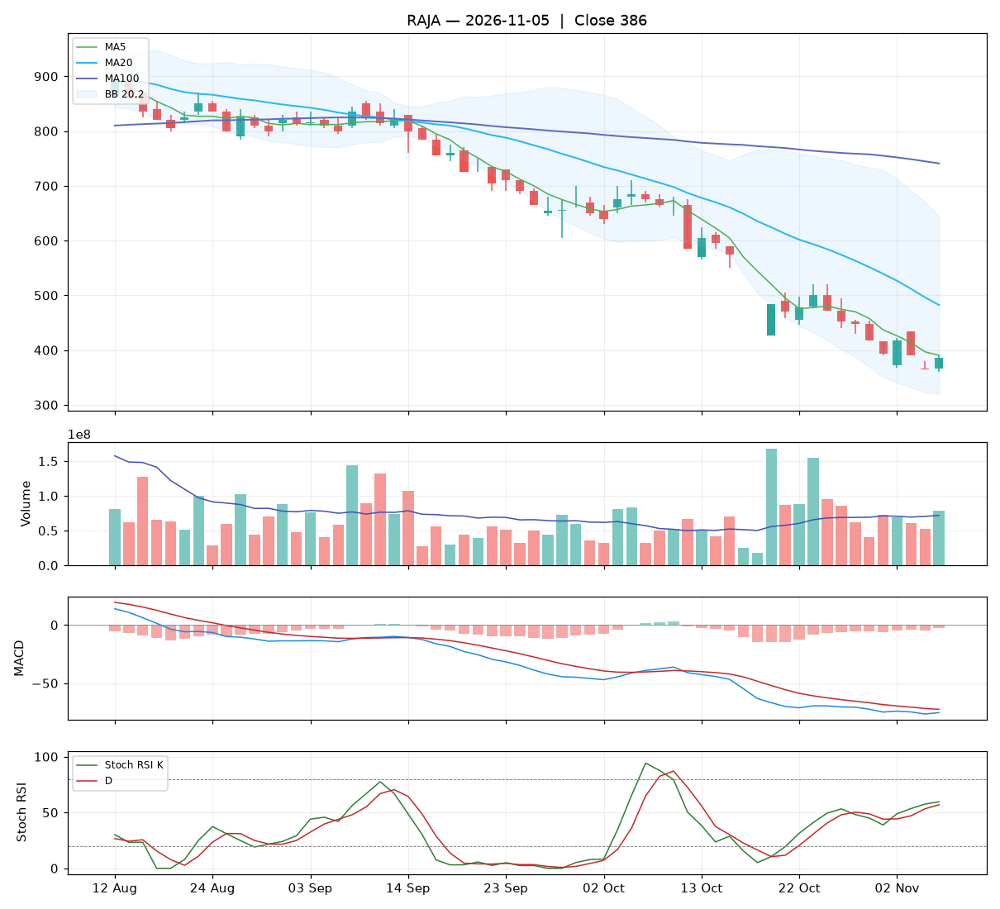

# Analisa harian RAJA — 2026-11-05

## Ringkasan

| Open | High | Low | Close | Perubahan | Volume |
|---|---|---|---|---|---|
| 366 | 392 | 360 | **386** | +22 (+6.04%) | 79.078.300 |

### 🔴 Keputusan teknikal: **HINDARI** — nilai total **3.9/10**

Mayoritas indikator searah turun. Bagi yang memegang, pertimbangkan batas rugi.

| Aspek | Nilai | |
|---|---|---|
| Tren | **0.0**/10 | `░░░░░░░░░░` |
| Volume | **5.9**/10 | `██████░░░░` |
| Stochastic | **5.0**/10 | `█████░░░░░` |
| Momentum | **4.0**/10 | `████░░░░░░` |
| Candle | **5.9**/10 | `██████░░░░` |

**Level harga (otomatis):**

- Support 20 hari: 360 · Resistance 20 hari: 680
- Batas rugi (stop loss): 360 (di bawah support atau −5%)
- Target 1: 482 · Target 2: 680
- Rasio untung : rugi ke target 1 = 3.70 : 1

## 1. Candlestick

Candle hijau (ditutup naik). Badan 62% dari rentang hari ini, sumbu atas 19%, sumbu bawah 19%.

- Tidak ada pola candle khusus yang terdeteksi.

## 2. Volume

- Volume hari ini 79.078.300 lembar, rata-rata 20 hari 71.916.780 (**1.10x** rata-rata).
- Volume normal.
- 5 hari terakhir: volume candle hijau 44%, candle merah 56%.

## 3. Stochastic & Stoch RSI

- Stochastic (14,3,3): %K 8.7, %D 9.8, zona **jenuh jual (oversold)**.
- %K memotong %D ke bawah.
- Stoch RSI (14,14,3,3): K 59.6, D 56.9, zona **tengah**.
- K di atas D: momentum masih naik.

## 4. Tren (Moving Average)

Tren jangka pendek: **turun** (MA20 berubah -69 dalam 5 hari).
- Harga di bawah MA5 (390).
- Harga di bawah MA20 (482).
- Harga di bawah MA100 (741).

## 5. Bollinger Bands

- Bollinger (20,2): atas 644, tengah 482, bawah 320. Posisi harga 20% dari pita bawah ke atas, lebar pita 67.3%.

## 6. MACD & RSI

- MACD (12,26,9): garis -75.31, sinyal -72.49, histogram -2.82.
- Histogram membaik dibanding kemarin: tekanan turun berkurang / tekanan naik bertambah.
- MACD masih di bawah nol: tren menengah masih lemah.
- RSI (14): 28.5 — oversold.

## 7. Support & Resistance

- Support 20 hari (low terendah): 360.
- Resistance 20 hari (high tertinggi): 680.
- Resistance terdekat lain: MA20 482, MA100 741.

## 8. Fundamental (laporan keuangan)

**Nilai fundamental: 9.4/10 — Kuat** (terpisah dari keputusan teknikal; dipakai untuk menilai kualitas perusahaan jangka panjang).

| PER | PBV | ROE | DER | Margin laba | Pendapatan YoY | Laba YoY | Kapitalisasi |
|---|---|---|---|---|---|---|---|
| 11.7 | 1.94 | 21.2% | 1.16x | 14.8% | 23.4% | 205.1% | 8.13 T |

Laporan keuangan emiten ini disajikan dalam **USD**. PBV dihitung ulang dengan kurs USD/IDR 18.075.

Laporan laba rugi per kuartal (juta USD):

| Periode | Pendapatan | Laba bersih |
|---|---|---|
| 2026-06-30 | 75.9 | 14.1 |
| 2026-03-31 | 55.3 | 8.6 |
| 2025-12-31 | 70.6 | 9.5 |
| 2025-09-30 | 68.4 | 6.4 |
| 2025-06-30 | 61.5 | 4.6 |

| Kondisi | Poin |
|---|---|
| PER 11.7x: wajar | +0.25 |
| ROE 21%: sangat efisien | +1.25 |
| Margin laba bersih 15%: sehat | +0.50 |
| Pendapatan tumbuh +23% YoY | +0.93 |
| Laba bersih tumbuh +205% YoY | +1.50 |

_Sumber: Yahoo Finance. Untuk keputusan penting, cocokkan dengan laporan resmi di idx.co.id._

## 9. Cara nilai teknikal dihitung

Setiap aspek mulai dari **5** (netral), lalu ditambah atau dikurangi poin di bawah ini, dan dibatasi 0–10. Nilai total = rata-rata berbobot.

**Tren: 0.0/10** (bobot 25%)

| Kondisi | Poin |
|---|---|
| Harga di bawah MA5 | -1.00 |
| Harga di bawah MA20 | -1.50 |
| Harga di bawah MA100 | -1.50 |
| MA20 menurun dalam 5 hari | -1.00 |

**Volume: 5.9/10** (bobot 20%)

| Kondisi | Poin |
|---|---|
| Harga naik dengan volume 1.10x rata-rata 20 hari | +1.10 |
| Volume hijau 5 hari 44% (akumulasi vs distribusi) | -0.22 |

**Stochastic: 5.0/10** (bobot 20%)

| Kondisi | Poin |
|---|---|
| Stochastic: K memotong D ke bawah | -1.50 |
| Stochastic oversold (9): peluang pantulan | +0.75 |
| Stoch RSI: K di atas D | +0.75 |

**Momentum: 4.0/10** (bobot 20%)

| Kondisi | Poin |
|---|---|
| MACD di bawah garis sinyal | -1.50 |
| MACD di bawah nol | -1.00 |
| Histogram MACD membaik | +1.00 |
| RSI 28 oversold, peluang pantulan | +0.50 |

**Candle: 5.9/10** (bobot 15%)

| Kondisi | Poin |
|---|---|
| Badan candle hijau 62% dari rentang | +0.94 |

_Laporan ini dibuat otomatis dari aturan teknikal sederhana. Bukan rekomendasi beli atau jual; selalu kombinasikan dengan analisa sendiri dan manajemen risiko._
