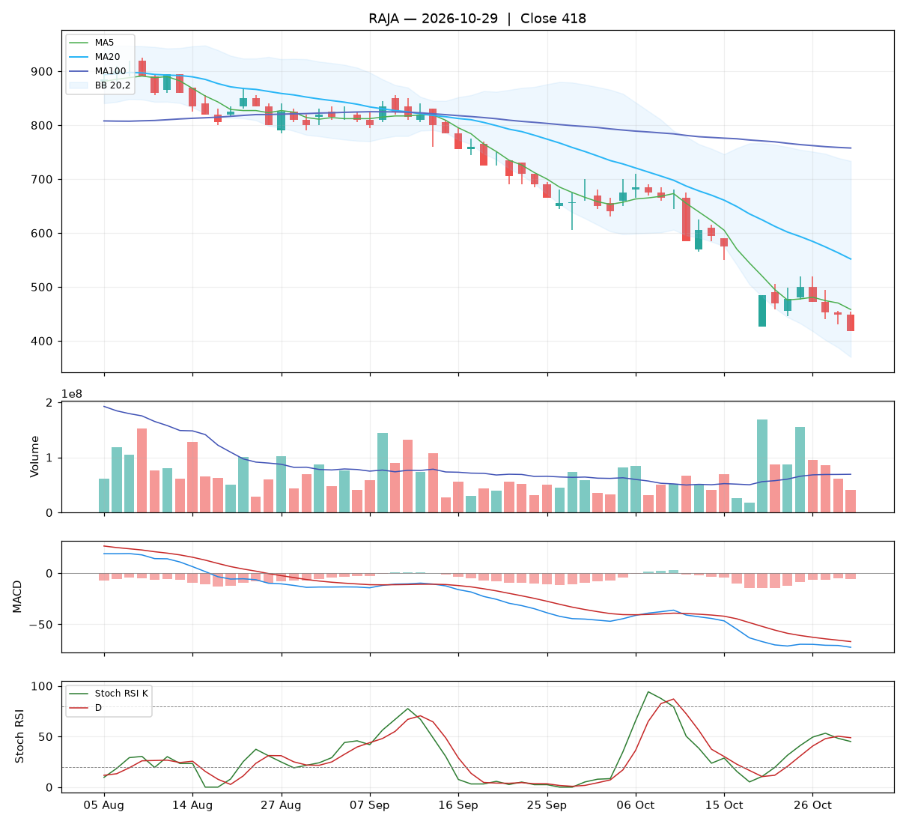

# Analisa harian RAJA — 2026-10-29

## Ringkasan

| Open | High | Low | Close | Perubahan | Volume |
|---|---|---|---|---|---|
| 448 | 454 | 418 | **418** | -30 (-6.70%) | 40.857.300 |

### 🔴 Keputusan teknikal: **HINDARI** — nilai total **2.6/10**

Mayoritas indikator searah turun. Bagi yang memegang, pertimbangkan batas rugi.

| Aspek | Nilai | |
|---|---|---|
| Tren | **0.0**/10 | `░░░░░░░░░░` |
| Volume | **3.8**/10 | `████░░░░░░` |
| Stochastic | **4.2**/10 | `████░░░░░░` |
| Momentum | **2.0**/10 | `██░░░░░░░░` |
| Candle | **3.8**/10 | `████░░░░░░` |

**Level harga (otomatis):**

- Support 20 hari: 418 · Resistance 20 hari: 710
- Batas rugi (stop loss): 397 (di bawah support atau −5%)
- Target 1: 552 · Target 2: 710
- Rasio untung : rugi ke target 1 = 6.39 : 1

## 1. Candlestick

Candle merah (ditutup turun). Badan 83% dari rentang hari ini, sumbu atas 17%, sumbu bawah 0%.

- Tidak ada pola candle khusus yang terdeteksi.

## 2. Volume

- Volume hari ini 40.857.300 lembar, rata-rata 20 hari 69.242.145 (**0.59x** rata-rata).
- Volume sepi: pergerakan hari ini kurang meyakinkan.
- 5 hari terakhir: volume candle hijau 35%, candle merah 65%.

## 3. Stochastic & Stoch RSI

- Stochastic (14,3,3): %K 6.2, %D 12.0, zona **jenuh jual (oversold)**.
- Stoch RSI (14,14,3,3): K 45.1, D 48.8, zona **tengah**.
- K di bawah D: momentum masih turun.

## 4. Tren (Moving Average)

Tren jangka pendek: **turun** (MA20 berubah -50 dalam 5 hari).
- Harga di bawah MA5 (458).
- Harga di bawah MA20 (552).
- Harga di bawah MA100 (758).

## 5. Bollinger Bands

- Bollinger (20,2): atas 733, tengah 552, bawah 370. Posisi harga 13% dari pita bawah ke atas, lebar pita 65.9%.

## 6. MACD & RSI

- MACD (12,26,9): garis -72.39, sinyal -66.86, histogram -5.53.
- Histogram memburuk dibanding kemarin.
- MACD masih di bawah nol: tren menengah masih lemah.
- RSI (14): 23.5 — oversold.

## 7. Support & Resistance

- Support 20 hari (low terendah): 418.
- Resistance 20 hari (high tertinggi): 710.
- Resistance terdekat lain: MA20 552, MA100 758.

## 8. Fundamental (laporan keuangan)

**Nilai fundamental: 9.4/10 — Kuat** (terpisah dari keputusan teknikal; dipakai untuk menilai kualitas perusahaan jangka panjang).

| PER | PBV | ROE | DER | Margin laba | Pendapatan YoY | Laba YoY | Kapitalisasi |
|---|---|---|---|---|---|---|---|
| 13.5 | 2.31 | 19.9% | 1.13x | 14.3% | 23.4% | 205.1% | 8.83 T |

Laporan keuangan emiten ini disajikan dalam **USD**. PBV dihitung ulang dengan kurs USD/IDR 18.125.

Laporan laba rugi per kuartal (juta USD):

| Periode | Pendapatan | Laba bersih |
|---|---|---|
| 2026-06-30 | 75.9 | 14.1 |
| 2026-03-31 | 55.3 | 8.6 |
| 2025-12-31 | 70.6 | 9.5 |
| 2025-09-30 | 68.4 | 6.4 |
| 2025-06-30 | 61.5 | 4.6 |

| Kondisi | Poin |
|---|---|
| PER 13.5x: wajar | +0.25 |
| ROE 20%: sangat efisien | +1.25 |
| Margin laba bersih 14%: sehat | +0.50 |
| Pendapatan tumbuh +23% YoY | +0.93 |
| Laba bersih tumbuh +205% YoY | +1.50 |

_Sumber: Yahoo Finance. Untuk keputusan penting, cocokkan dengan laporan resmi di idx.co.id._

## 9. Cara nilai teknikal dihitung

Setiap aspek mulai dari **5** (netral), lalu ditambah atau dikurangi poin di bawah ini, dan dibatasi 0–10. Nilai total = rata-rata berbobot.

**Tren: 0.0/10** (bobot 25%)

| Kondisi | Poin |
|---|---|
| Harga di bawah MA5 | -1.00 |
| Harga di bawah MA20 | -1.50 |
| Harga di bawah MA100 | -1.50 |
| MA20 menurun dalam 5 hari | -1.00 |

**Volume: 3.8/10** (bobot 20%)

| Kondisi | Poin |
|---|---|
| Harga turun dengan volume 0.59x rata-rata 20 hari | -0.59 |
| Volume hijau 5 hari 35% (akumulasi vs distribusi) | -0.59 |

**Stochastic: 4.2/10** (bobot 20%)

| Kondisi | Poin |
|---|---|
| Stochastic: K di bawah D | -0.75 |
| Stochastic oversold (6): peluang pantulan | +0.75 |
| Stoch RSI: K di bawah D | -0.75 |

**Momentum: 2.0/10** (bobot 20%)

| Kondisi | Poin |
|---|---|
| MACD di bawah garis sinyal | -1.50 |
| MACD di bawah nol | -1.00 |
| Histogram MACD memburuk | -1.00 |
| RSI 23 oversold, peluang pantulan | +0.50 |

**Candle: 3.8/10** (bobot 15%)

| Kondisi | Poin |
|---|---|
| Badan candle merah 83% dari rentang | -1.25 |

_Laporan ini dibuat otomatis dari aturan teknikal sederhana. Bukan rekomendasi beli atau jual; selalu kombinasikan dengan analisa sendiri dan manajemen risiko._
